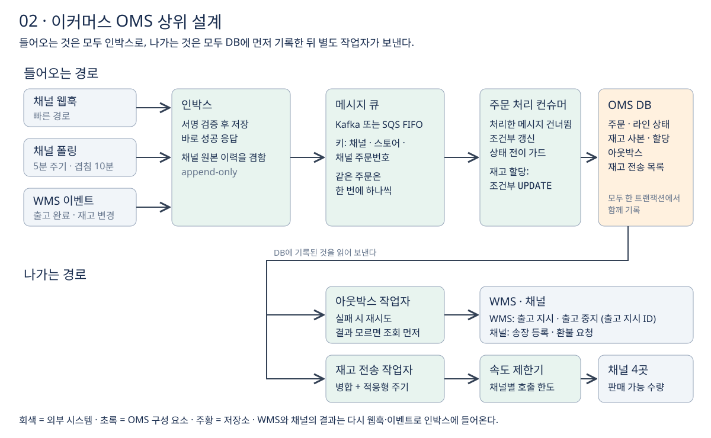

# 3단계 상위 설계

[1단계 요구사항](01-요구사항-정리.md)에서 정한 기능을 어떤 구성 요소로 나누고 데이터가 어떻게 흐르는지 정한다. 비기능 요구를 미뤘으므로 서버 대수나 파티션 수 같은 규모는 정하지 않고, **구성 요소의 책임과 동시성·실패 처리**에 집중한다. 고객 조회·백오피스의 API와 데이터 모델은 다음 라운드에서 정한다.



**들어오는 것은 모두 인박스로, 나가는 것은 모두 DB에 먼저 기록한 뒤 별도 작업자가 보낸다.** 이 한 문장이 전체 구조다.

## 1 구성 요소와 책임

| 구성 요소 | 책임 |
| --- | --- |
| 웹훅 수신부 | 서명을 검증하고 인박스에 저장한 뒤 바로 성공을 응답한다 |
| 폴링 작업 | 5분마다 채널 API를 조회해 결과를 인박스에 넣는다 |
| 인박스 | 채널·WMS에서 온 원본을 append-only로 쌓는다. 채널 원본 이력을 겸한다 |
| 메시지 큐 | 주문 키로 묶어 같은 주문의 메시지를 차례대로 전달한다 |
| 주문 처리 컨슈머 | 공통 모델로 변환하고, 주문 상태를 조건부로 갱신하고, 재고를 할당한다 |
| OMS DB | 주문·라인 상태, WMS 재고 사본과 할당 수량, 아웃박스, 재고 전송 목록 |
| 아웃박스 작업자 | WMS에 출고 지시·출고 중지를, 채널에 송장 등록·환불 요청을 보낸다 |
| 재고 전송 작업자 | 바뀐 판매 가능 수량을 모아 채널 4곳에 보낸다 |
| 속도 제한기 | 채널별 API 호출 한도를 넘지 않게 한다 |

## 2 들어오는 경로

### 인박스 패턴

오픈마켓은 웹훅에 빠른 응답을 요구한다. 정해진 시간 안에 성공 응답이 없으면 실패로 보고 재시도한다. 반면 주문 하나를 처리하려면 변환, 조건부 갱신, 재고 할당, 판매 가능 수량 재계산까지 할 일이 많다. 그래서 **받는 일과 처리하는 일을 나눈다.**

1. **채널에는 빠르게 응답한다.** 웹훅 수신부는 서명 검증과 인박스 저장만 한다. 서명 검증은 저장 전에 해야 위조된 웹훅이 쌓이지 않는다.
2. **폴링과 WMS 이벤트도 같은 인박스에 넣는다.** 들어온 경로와 상관없이 이후 처리 경로가 하나가 되고, 중복 판정과 조건부 갱신도 한 곳에서만 한다.
3. **처리에 실패해도 원본이 남는다.** 원본을 다시 처리하면 된다.

모든 상태 전이를 받는 순간 끝낼 필요는 없다. 다만 당일 출고 마감이 있는 사업이라면 처리 지연이 마감 안에 들어와야 하므로, 미뤄 둔 비기능 요구의 지연 목표와 연결된다.

### 같은 주문은 한 번에 하나씩

컨슈머가 여러 대일 때 같은 주문의 "생성"과 "취소"를 동시에 처리하면 문제가 생긴다.

| 시각 | 컨슈머 A (주문 X 생성) | 컨슈머 B (주문 X 취소) |
| --- | --- | --- |
| t1 | 주문 X 저장 (수집됨) | |
| t2 | 재고 확인, 할당 시작 | 주문 X 조회: 아직 할당 없음 |
| t3 | | 취소됨으로 변경. 풀어 줄 할당이 없어 그대로 끝 |
| t4 | 할당 수량 +1 저장 | |
| t5 | 아웃박스에 출고 지시 저장 | |

취소된 주문에 재고가 묶이고, 출고 지시까지 나간다. 두 컨슈머는 각자 맞게 일했지만 **같은 주문을 동시에 만졌다.**

**주문 키 `(채널, 스토어, 채널 주문번호)`로 메시지를 묶는다.** 1단계의 유니크 키와 같은 값이다. OMS 내부 주문 ID는 웹훅이 처음 도착할 때 아직 없으므로 쓸 수 없다.

| | Kafka | SNS·SQS |
| --- | --- | --- |
| 묶는 단위 | 파티션 키 | 메시지 그룹 ID. FIFO 토픽과 FIFO 큐가 필요하다 |
| 보장 | 같은 키는 같은 파티션에 들어가고, 한 파티션은 컨슈머 그룹 안에서 컨슈머 하나에만 배정된다 | 같은 그룹 ID는 앞의 메시지가 처리 완료(삭제)되기 전까지 다른 컨슈머에게 가지 않는다 |
| 주의 | 컨슈머가 받은 메시지를 별도 스레드 풀에 넘겨 병렬로 처리하면 순서 보장이 컨슈머 안에서 깨진다 | 일반(Standard) 큐는 순서를 보장하지 않는다. 처리 시간이 가시성 타임아웃을 넘기면 다른 컨슈머가 같은 메시지를 또 받는다 |

컨슈머는 서버 한 대가 아니라 **컨슈머 인스턴스 하나**다. 서버 한 대가 컨슈머 스레드를 여러 개 띄우면 각각이 별개의 컨슈머다.

두 방식 모두 최소 한 번 전달이라 **같은 메시지가 다시 올 수 있다.** 처리한 메시지 ID를 기록하고 이미 처리한 메시지는 건너뛴다.

## 3 재고 할당

### 다른 주문이 같은 재고를 다툴 때

주문 키로 묶으면 같은 주문의 동시 처리는 막지만, **다른 주문이 같은 상품을 다투는 경우**는 막지 못한다. 판매 가능 수량이 1개 남은 상품 A에 주문 P와 T가 동시에 들어오면, 두 컨슈머가 모두 "1 ≥ 1"을 확인하고 할당해 재고 1개에 할당이 2개 잡힌다.

부딪히는 대상이 주문이 아니라 상품(SKU)이기 때문이다. SKU로 파티션을 나눌 수도 없다. 주문 하나에 상품이 여러 개면 어느 파티션에 넣을지 정할 수 없고, 한 상품에 주문이 몰리면 파티션 하나에 몰린다.

**판단을 UPDATE 조건에 넣어 DB가 직접 판단하게 한다.**

```sql
UPDATE stock
SET allocated = allocated + :quantity
WHERE sku = :sku AND warehouse_id = :warehouse_id
  AND wms_quantity - allocated - safety_stock >= :quantity;
-- 바뀐 행이 1이면 할당 성공, 0이면 재고 부족 또는 충돌
```

DB는 같은 행을 바꾸는 UPDATE를 하나씩 처리하므로, 뒤에 실행된 UPDATE는 앞의 결과가 반영된 값으로 조건을 다시 확인한다. "조회하고 판단하고 저장"하는 사이의 틈이 사라진다.

분산 락(Redis 등)으로도 막을 수 있지만 고르지 않았다. 시스템이 하나 늘어 그 시스템이 죽으면 할당이 멈추고, 락 만료 시간 안에 처리가 끝나지 않으면 두 컨슈머가 동시에 락을 가졌다고 믿는 순간이 생긴다. **지켜야 할 데이터가 DB 한 곳에 있으면 락도 그 DB에서 건다.** 분산 락은 지켜야 할 대상이 여러 시스템에 걸쳐 있을 때 꺼낸다.

### 상품이 여러 개인 주문

1. **계획:** 락 없이 재고 사본을 읽고, 1단계의 창고 선택 규칙으로 라인별 창고를 정한다.
2. **실행:** 한 트랜잭션에서 라인마다 조건부 UPDATE를 실행한다. 재고를 모두 잡으면 같은 트랜잭션에서 라인 상태를 바꾸고 아웃박스에 출고 지시를 저장한다.
3. **재계획:** UPDATE 하나라도 0행이면 계획한 사이에 다른 주문이 재고를 가져간 것이다. 트랜잭션 전체를 롤백하고 1번부터 다시 한다. 재시도 횟수는 제한하고, 다 쓰면 실패로 끝내 메시지가 다시 전달되게 한다.

충돌이 드물다고 보고 일단 진행한 뒤 충돌하면 다시 하는 **낙관적 동시성 제어**다. 라인마다 따로 할당하지 않고 계획을 먼저 세우는 이유는, 따로 할당하면 한 창고에서 모두 보낼 수 있었던 주문이 여러 창고로 흩어지기 때문이다.

UPDATE 결과가 0행일 때 충돌인지 재고 부족인지는 구분하지 않아도 된다. 다시 계획하면 재고가 정말 없는 라인은 새 계획에서 할당할 수 없는 라인으로 분류되고, 다음 시도에서 `할당 보류`로 정상 커밋된다.

**교착 상태 방지:** 주문 Y가 A → B, 주문 Z가 B → A 순서로 UPDATE하면 서로 상대가 잡은 행을 기다릴 수 있다. 한 트랜잭션 안의 UPDATE는 항상 `(SKU, 창고)` 순서로 정렬해 실행한다.

### 일부 라인만 재고가 없을 때

주문 Y의 상품 A는 할당됐지만 상품 B는 창고 3곳 모두 재고가 없다.

- **다른 창고는 WMS에 묻지 않고 OMS DB의 재고 사본에서 찾는다.** 할당 도중 WMS를 호출하면 느려지고, WMS가 답한 순간과 할당하는 순간 사이에 다른 주문이 가져갈 수 있다.
- **A는 할당한 채로 커밋하고 먼저 출고한다.** 분할 출고를 허용했으므로 B를 기다리지 않는다(정책 가정). A의 할당을 풀면 다른 주문이 A를 가져가 A까지 보내지 못할 수 있다.
- **B는 `할당 보류`로 둔다.** 재입고 이벤트가 오면 보류 라인을 주문 시각 순서로 다시 할당하고, 출고 기한이 다가오면 운영자에게 알린다. 운영자가 부분 취소를 결정하면 아웃박스로 채널에 B만 환불을 요청한다.
- **"A만 결제"는 없다.** 결제는 채널이 주문 전체로 이미 끝냈다. OMS는 B를 부분 취소하고 환불을 요청할 뿐이다.

## 4 나가는 경로

### 아웃박스 패턴

OMS가 WMS나 채널에 보내는 명령은 바로 호출하지 않고, **상태 변경과 같은 트랜잭션에서 아웃박스에 저장**한다. 별도 작업자가 아웃박스를 읽어 보내고 실패하면 재시도한다.

- 할당은 됐는데 출고 지시가 안 남는 일도, 출고 지시만 남고 할당은 안 된 일도 생기지 않는다.
- WMS가 잠시 죽어도 명령이 사라지지 않는다.

### 세 가지 키

| 키 | 누가 만드나 | 용도 |
| --- | --- | --- |
| 주문 키 `(채널, 스토어, 채널 주문번호)` | 채널이 준 값 | 같은 주문을 같은 파티션·그룹으로 보내 차례대로 처리 |
| 수신 메시지 ID | 보낸 쪽 (채널, WMS) | 인박스에 같은 메시지가 다시 와도 한 번만 처리 |
| 출고 지시 ID | OMS | WMS에 보내는 명령의 멱등키 |

**출고 지시 ID는 아웃박스에 저장할 때 한 번만 만든다.** 보낼 때마다 만들면 재시도할 때마다 키가 바뀌어 WMS가 재시도를 새 출고 지시로 본다. WMS는 출고 완료 이벤트에 출고 지시 ID를 담아 돌려주고, OMS는 이 ID로 주문 키를 찾아 메시지 큐의 키로 쓴다. 분할 출고로 주문 하나에 출고 지시가 여러 건 생길 수 있으므로 주문 키가 아니라 출고 지시 ID를 보낸다.

### WMS가 멱등키를 지원하지 않을 때

외부 물류 대행사(3PL)의 WMS가 중복을 걸러 주지 않으면 OMS가 스스로 방어한다.

1. **외부 참조번호 필드를 찾는다.** "고객사 주문번호" 같은 필드에 출고 지시 ID를 넣는다. 3PL이 이 값의 중복을 거부하면 사실상 멱등키이므로, "이미 존재함" 오류는 성공으로 처리한다.
2. **결과를 모르는 실패만 따로 다룬다.** 연결 자체가 안 됐거나 요청 형식 오류처럼 WMS가 받지 않은 게 확실하면 그냥 재시도한다. 요청을 보낸 뒤 타임아웃처럼 결과를 모르면, 외부 참조번호로 먼저 조회하고 없을 때만 다시 보낸다.
3. **주기적으로 대사한다.** OMS의 출고 지시 목록과 WMS의 출고 목록을 대조해 중복은 피킹 전에 출고 중지를 요청하고, 누락은 다시 보낸다.
4. 건수가 적고 실수 비용이 크면 결과를 모르는 실패를 `확인 필요`로 두고 운영자에게 넘긴다.

**결과를 모를 때는 재시도 쪽을 고른다.** 중복 출고와 출고 누락 중 누락이 더 나쁘다고 판단했다.

| | 중복 출고 | 출고 누락 |
| --- | --- | --- |
| 손실 | 상품 원가와 배송비 | 출고 기한 초과 시 채널 페널티, 고객 이탈 |
| 알아차리는 시점 | 대사로 피킹 전에 잡을 수 있다. 늦어도 WMS 재고가 1 더 줄어든 것이 재고 동기화에서 드러난다 | 아무도 모른다. OMS는 보냈다고 믿고 WMS는 받은 적이 없다. 고객 문의나 기한 초과로 드러난다 |

**누락은 조용히 일어나고 중복은 흔적을 남긴다.** 고가 상품처럼 중복 출고의 손실이 페널티보다 큰 사업이라면 판단이 뒤집힐 수 있다.

## 5 채널 재고 전송

판매 가능 수량이 바뀔 때마다 채널 4곳에 바로 보내면, 1초에 10건씩 팔리는 라이브 방송 상품 하나로만 1초에 40번을 호출한다(가정). 채널의 호출 한도에 막히면 채널 화면의 수량이 갱신되지 않아 초과 판매로 이어진다.

### 바뀐 것만 모아 최신 값 하나로 보낸다

```
할당·취소·재고 변경 → 재고 전송 목록에 (SKU, 채널)별 최신 수량을 덮어쓴다
                    → 재고 전송 작업자가 주기마다 목록을 비우며 보낸다
```

- 10번 바뀌어도 목록에는 마지막 값 하나만 남는다. 채널에 필요한 것은 변경 이력이 아니라 지금의 수량이라서 중간 값을 버려도 된다. 이를 **병합(coalescing)**이라고 한다.
- 모든 상품을 주기마다 보내지 않는다. 바뀌지 않은 상품까지 보내면 호출 대부분이 낭비다.
- 채널이 여러 상품을 한 번에 갱신하는 일괄 API를 제공하면 호출이 더 줄어든다.
- 그래도 채널마다 호출 한도가 있으므로 채널별 속도 제한기를 거친다.

### 소진 예상 시간에 따라 주기를 다르게

주기를 늘리면 호출은 줄지만 동기화 시간이 늘어 [안전 재고](01-요구사항-정리.md#안전-재고)가 커진다. 그래서 급한 상품만 빠르게 보낸다. 급한 정도는 수량이 아니라 `남은 수량 ÷ 판매 속도`, 즉 **소진 예상 시간**으로 판단한다. 100개 남았어도 1초에 10개씩 팔리면 10초 뒤 품절이고, 3개 남았어도 하루에 1개 팔리면 사흘이 남는다.

| 소진 예상 시간 (가정) | 전송 |
| --- | --- |
| 1시간 이상 | 5분마다 |
| 1분 ~ 1시간 | 30초마다 |
| 1분 미만, 또는 판매 가능 수량 0 | 즉시 |

초과 판매는 수량이 0에 가까울 때 일어나므로, 급한 상품의 동기화 시간이 짧아지면 안전 재고가 필요한 곳에서 커지지 않는다. 판매 속도는 안전 재고 계산에 이미 쓰는 값이다.

## 4단계에서 파고들 병목 후보

- **한 상품에 몰리는 할당:** 라이브 방송처럼 한 상품에 주문이 몰리면 모든 조건부 UPDATE가 같은 재고 행에서 줄을 서고, 재계획 재시도도 그 상품에 몰린다.
- **채널 API 호출 한도:** 폴링, 재고 전송, 송장 등록이 모두 같은 채널의 호출 한도를 나눠 쓴다.

## 가정한 값과 확인할 것

| 항목 | 값 | 근거 |
| --- | --- | --- |
| 메시지 큐 | Kafka 또는 SNS·SQS FIFO | 가정 |
| WMS 연동 | 이벤트는 인박스로, 명령은 아웃박스로 | 가정 |
| 일부 라인 재고 없음 | 있는 라인은 먼저 출고 | 분할 출고 허용에 따른 정책 가정 |
| 결과를 모르는 출고 지시 | 조회 후 재전송 + 대사 | 출고 누락이 중복보다 나쁘다고 판단 |
| 라이브 방송 판매 속도 | 1초에 10건 | 가정 |
| 재고 전송 주기 | 소진 예상 시간에 따라 즉시 · 30초 · 5분 | 가정 |

- [ ] 메르카도리브레 알림이 주문 전체가 아니라 변경 신호만 주는지 확인한다. 그렇다면 인박스에는 알림이 아니라 다시 조회한 주문 데이터를 원본으로 남긴다.
- [ ] 각 채널이 재고 일괄 갱신 API를 제공하는지 확인한다.
- [ ] 연동할 3PL WMS가 외부 참조번호의 중복을 거부하는지, 그 값으로 조회할 수 있는지 확인한다.

## 다음 단계

고객 주문 조회와 운영자 백오피스의 API, 그리고 주문·라인·출고·재고 데이터 모델을 정한다.

설계하며 판단이 갈린 질문은 [설계 질문 목록](부록-설계-질문-목록.md)에 모았다.
