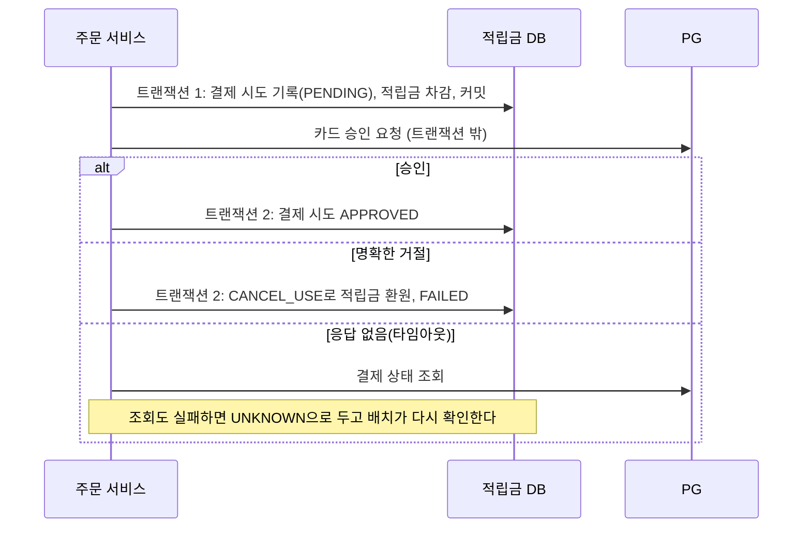

# 1부 적립금 원장과 동시 사용

**가상의 쇼핑몰 적립금**을 설계한다. 특정 회사의 시스템과 무관하며, 실무 근거가 없는 값은 모두 가정으로 표시한다. 이 문서는 잔액을 어떻게 저장할지에서 시작해 취소, 회수, 동시 사용, 카드와 함께 결제하는 경우까지를 문답으로 정한 결과다.

**공통 상황 (가정)**

- **적립:** 구매를 확정하면 결제 금액의 1%를 적립한다. 리뷰 작성이나 이벤트로도 적립된다.
- **사용:** 결제할 때 1원 단위로 원하는 만큼 쓴다.
- **유효기간:** 적립 후 1년이 지나면 소멸한다.
- **취소:** 주문을 취소하면 쓴 적립금은 돌려주고, 이미 받은 적립금은 회수한다.

> 적립금은 숫자 하나가 아니라 **언제 적립되어 언제 만료되는 돈의 묶음**이다. 사용, 취소, 소멸은 모두 "어느 묶음에서 얼마를"이라는 질문에 답해야 한다.

## 1 잔액 숫자 하나로는 부족하다

회원 테이블에 `point_balance` 컬럼 하나를 두고 적립할 때 더하고 사용할 때 빼면 잔액은 바로 나온다. 이력이 남지 않는 문제는 이력 테이블을 옆에 붙이면 풀린다. 더 큰 문제는 **잔액이 하나로 합쳐져 언제 적립된 적립금인지 알 수 없다**는 것이다.

| 요구 | 숫자 하나로 막히는 이유 |
| --- | --- |
| 유효기간 소멸 | 잔액 3,000원 중 오늘 만료되는 금액을 알 수 없다 |
| 취소 환원 | 돌려줄 적립금의 만료일을 정하려면 어느 적립 건에서 썼는지 알아야 한다 |
| 적립 회수 | 받은 적립금을 이미 썼다면 잔액이 마이너스가 될 수 있다 |

### 이력 테이블을 붙여도 소멸 금액은 바로 나오지 않는다

`point_history(member_id, amount, reason, created_at)`에 적립은 `+`, 사용은 `-`로 쌓았다.

| 날짜 | 내용 | amount |
| --- | --- | --- |
| 2026-03-01 | 구매 적립 | +1,000 |
| 2026-06-01 | 리뷰 적립 | +1,000 |
| 2026-07-01 | 결제에 사용 | -1,500 |

7/1에 쓴 1,500원을 어느 적립 건에서 뺐다고 보느냐에 따라 소멸 금액이 달라진다.

| 사용 순서 규칙 | 7/1 사용분 | 2027-03-01 소멸 | 2027-06-01 소멸 |
| --- | --- | --- | --- |
| 만료가 임박한 것부터 | 3월분 1,000 + 6월분 500 | 0 | 500 |
| 최근 적립분부터 | 6월분 1,000 + 3월분 500 | 500 | 0 |

이 설계는 고객에게 유리한 **만료 임박 순 사용**을 고른다. 이벤트 적립처럼 유효기간이 적립 건마다 다르면 `created_at + 1년`으로 계산할 수 없으므로 `expires_at`을 저장한다.

이력 테이블은 얼마가 들어오고 나갔는지만 남기고, 사용분이 어느 적립 건에서 빠졌는지는 남기지 않는다. 그래서 소멸 금액을 알려면 매번 전체 이력을 처음부터 다시 맞춰 봐야 한다.

## 2 원장과 적립 건 나누기

모든 거래를 쌓는 원장, 적립 건별로 남은 금액, 그리고 둘을 잇는 사용 상세를 둔다.

| 테이블 | 한 행의 의미 | 주요 컬럼 | 변경 |
| --- | --- | --- | --- |
| `point_transaction` (원장) | 적립·사용·소멸·취소 거래 1건 | `type`, `amount`, `order_id`, `created_at` | 추가만 한다 |
| `point_earning` (적립 건) | 적립 1건과 남은 금액 | `amount`, `remaining_amount`, `expires_at` | `remaining_amount`만 줄거나 되돌아간다 |
| `point_usage_detail` (사용 상세) | 거래 1건이 적립 건 하나의 남은 금액을 바꾼 양. 줄이면 `-`, 늘리면 `+` | `transaction_id`, `earning_id`, `amount` | 추가만 한다 |
| `point_wallet` (회원 잔액) | 회원의 현재 잔액 | `member_id`, `balance` | 거래마다 갱신한다 |

> 2부에서 소멸, 회수, 보정도 이 테이블에 쌓게 되어 이름을 `point_transaction_detail`(거래 상세)로 넓혔다. 최종 구조는 [2부 최종 데이터 모델](02-소멸과-정합성-검증.md#최종-데이터-모델)에 있다.

7/1의 사용 1,500원은 이렇게 남는다.

- 원장: `USE -1,500` 1행
- 사용 상세: `(3월분, -1,000)`, `(6월분, -500)` 2행
- 적립 건: 3월분 `remaining_amount` 0, 6월분 500
- 회원 잔액: 500

이렇게 나누면 각 질문을 한 곳에서 답할 수 있다.

- **소멸:** `expires_at <= 오늘 AND remaining_amount > 0`인 적립 건만 찾는다.
- **잔액:** 적립 건의 `remaining_amount` 합계와 같다. 화면에는 회원 잔액을 바로 보여 준다. 회원 잔액은 [5 동시 사용](#_5-동시-사용과-중복-요청)에서 잠금 지점 역할도 맡는다.
- **취소:** 사용 상세를 보고 원래 적립 건에 되돌린다.

## 3 사용 취소

7/1에 적립금 1,500원을 쓴 주문을 7/5에 취소한다.

- **원장:** 사용 행을 고치거나 지우지 않고 `CANCEL_USE +1,500` 행을 새로 쌓는다. 취소한 원래 사용 거래의 ID를 함께 남긴다.
- **사용 상세:** 취소 거래 기준으로 `(3월분, +1,000)`, `(6월분, +500)`을 쌓는다. 지우지 않아야 언제 쓰고 언제 돌려받았는지 추적할 수 있다.
- **적립 건:** 사용 상세를 근거로 `remaining_amount`를 되돌린다.
- **중복 취소:** 원래 사용 거래 1건에 취소가 1건만 있도록 유니크 제약을 건다. 같은 취소 요청이 두 번 와도 두 번 환원되지 않는다.

### 이미 만료된 적립금을 돌려줄 때

같은 주문을 2027-04-01에 취소하면 3월분의 원래 만료일(2027-03-01)이 이미 지났다. 이건 기술보다 정책 문제다.

| 정책 | 동작 | 고객 | 회사 |
| --- | --- | --- | --- |
| A. 원래 만료일 유지 | 3월분을 원래 건에 되돌리고 바로 소멸시킨다 | 반품했는데 1,000원이 사라져 민원이 생긴다 | 단순하고 미사용 적립금이 늘지 않는다 |
| B. 새 1년 부여 | 1,500원 전부를 오늘 기준 1년짜리 새 적립 건으로 발급한다 | 손해가 없다 | 만료가 가까운 적립금으로 결제했다가 취소하면 유효기간이 1년 늘어나 악용된다 |
| C. 만료된 분만 짧게 재발급 | 6월분 500은 원래 건에 되돌리고, 만료된 3월분 1,000만 짧은 기간(예: 30일, 가정)의 새 적립 건으로 발급한다 | 쓸 기회가 생긴다 | 악용해도 이득이 작다 |

C를 고른다. 고객의 손해와 악용 여지를 함께 줄인다. 어느 정책이든 약관에 적어 둔다.

정책은 바뀔 수 있다. 하지만 1,500원 중 어느 부분이 만료됐는지 알아야 그 부분만 다르게 처리할 수 있으므로, **사용 상세를 남겨 두면 어떤 정책이든 구현할 수 있다.**

> 회계 메모: 지급했지만 아직 쓰이지 않은 적립금은 회사의 부채로 잡는 것이 일반적이다. 정책 B는 이 부채가 오래 남게 한다. 회계 처리는 회사와 기준서에 따라 다르므로 확인이 필요하다.

## 4 적립 회수

1. 주문 A를 구매 확정해서 1,000원을 적립받았다.
2. 그 1,000원을 주문 B에 모두 썼다.
3. 주문 A가 반품됐다. 1,000원을 회수해야 하는데 남은 금액이 0원이다.

회사가 손해를 볼지 고객에게 부담시킬지의 양자택일처럼 보이지만, 실제로는 **회수할 시점을 고르는 문제**에 가깝다. 아래 방법을 순서대로 겹쳐 쓴다.

| 순서 | 방법 | 동작 | 한계 |
| --- | --- | --- | --- |
| 1 | 적립 시점 늦추기 | 결제 시점이 아니라 구매 확정이나 반품 가능 기간이 끝난 뒤에 적립한다 | 고객이 적립을 늦게 받는다. 구매 확정 뒤의 예외 반품은 막지 못한다 |
| 2 | 환불 금액에서 빼기 | 반품 환불액에서 회수하지 못한 적립금만큼 빼고 돌려준다 | 돈이 오가는 마지막 기회다. 회수액이 환불액보다 크면 다 못 뺀다 |
| 3 | 미회수 기록 후 상계 | 못 받은 금액을 기록해 두고 다음 적립에서 먼저 뺀다 | 고객이 다시 적립받지 않거나 탈퇴하면 받지 못한다 |
| 4 | 손실 처리 | 회사가 부담한다 | 금액이 작거나 회수 비용이 더 크면 합리적이다 |

이 시나리오는 구매 확정 후에 적립하므로 1번이 이미 적용돼 있다.

### 회수할 때 테이블에서 일어나는 일

적립 건 1,000원 중 300원이 남아 있었다면, 남은 300원은 바로 회수한다. 원장에 `REVOKE -300`을 쌓고 적립 건의 `remaining_amount`를 0으로 바꾼다. 모자란 700원은 2~4번으로 처리한다. 3번을 고르면 어디에 기록할지 정해야 한다.

| 기록 방식 | 동작 | 문제 |
| --- | --- | --- |
| 마이너스 잔액 허용 | 잔액이 -700원이 된다 | 화면 표시와 사용 가능 여부 판단이 복잡해진다. 음수 적립 건은 "쓸 수 있는 돈"이라는 의미를 깬다 |
| 별도 회수 대기 테이블 | `point_debt(member_id, amount, remaining_amount, reason)`에 700원을 기록하고, 새 적립이 생기면 먼저 여기서 뺀다 | 적립 처리에 단계가 하나 는다 |

별도 테이블을 고른다. 적립 건은 쓸 수 있는 돈으로, 받을 돈은 받을 돈으로 따로 센다.

## 5 동시 사용과 중복 요청

잔액이 1,000원인 회원이 탭 두 개에서 각각 800원을 쓰는 결제를 거의 동시에 눌렀다. 두 요청 모두 `remaining_amount`를 1,000원으로 읽으면 둘 다 통과해서 1,600원을 쓰게 된다. 막으려면 락을 거는데, **무엇을 어떤 방식으로 잠글지**를 정해야 한다.

### 무엇을 잠글까

| 잠금 대상 | 동작 | 문제 |
| --- | --- | --- |
| 적립 건 여러 행 | 만료 임박 순으로 조회하면서 `FOR UPDATE` | 잠그는 행이 여러 개라 순서가 어긋나면 데드락이 난다. 항상 `expires_at, id` 순으로 잠가야 한다 |
| 회원 잔액 1행 | `point_wallet`을 먼저 `FOR UPDATE`로 잠근 뒤 적립 건을 차감한다 | 같은 회원의 요청이 이 한 행에서 줄을 선다 |

회원 잔액 1행을 잠근다. 한 회원이 동시에 결제하는 일은 드물어서 줄을 서도 느려지지 않고, 잠그는 지점이 하나라 데드락도 없다.

### 어떤 방식으로

| 방식 | 동작 | 맞는 경우 |
| --- | --- | --- |
| 비관적 락 | `SELECT ... FOR UPDATE`로 잠근 뒤 확인하고 차감한다 | 기본 선택이다 |
| 조건부 UPDATE | `UPDATE point_wallet SET balance = balance - 800 WHERE member_id = ? AND balance >= 800`을 실행하고, 바뀐 행이 0이면 잔액 부족으로 처리한다 | 확인과 차감을 한 문장으로 끝낸다. 이 문장이 행을 잠그므로 이어지는 적립 건 차감도 같은 트랜잭션 안에서 줄을 선다 |
| 낙관적 락(`version`) | 충돌하면 실패시키고 다시 시도한다 | 충돌이 드물 때. 재시도 코드가 필요하다 |
| Redis 분산 락 | DB 밖에서 잠근다 | DB만으로 막을 수 있으면 쓰지 않는다. 락 만료와 트랜잭션 종료 시점이 어긋날 수 있다 |

조건부 UPDATE는 `balance`가 정확하다는 전제가 필요하다. 만료됐지만 배치가 아직 처리하지 않은 금액이 섞이면 확인이 틀리므로, 2부에서 [쓰기 전에 먼저 소멸](02-소멸과-정합성-검증.md#쓰기-전에-먼저-소멸시킨다)시키는 규칙을 더했다.

### 락으로 막지 못하는 것

결제 버튼을 두 번 눌렀거나 클라이언트가 네트워크 오류로 재시도하면 **같은 요청이 차례로** 두 번 들어온다. 락은 동시에 들어온 요청을 줄 세울 뿐이라 두 번째 요청도 잔액이 충분하면 그대로 차감된다.

- 동시성 문제는 **락**으로 막는다.
- 중복 요청은 **멱등성**으로 막는다. 원장의 사용 거래에 `(order_id, type)` 유니크 제약을 걸어 같은 주문의 사용이 두 번 쌓이지 않게 한다.

## 6 적립금과 카드 복합 결제

30,000원 주문을 적립금 1,000원과 카드 29,000원으로 결제한다. 카드 승인은 외부 PG가 처리한다.

### 순서: 되돌리기 쉬운 것부터

적립금을 먼저 차감한다. 카드 승인을 먼저 하면 돈은 빠져나갔는데 적립금이 부족해 주문이 실패할 수 있고, 그때는 외부 PG에 승인 취소를 요청해야 한다. **내부에서 싸게 되돌릴 수 있는 작업을 먼저, 외부의 돈이 움직이는 작업을 나중에** 둔다.

### 트랜잭션을 나누고 PG 호출은 밖에서

회원 잔액 락을 잡은 트랜잭션 안에서 PG를 호출해도 동작은 한다. 하지만 트랜잭션이 길어져 위험하다.

- PG 응답을 기다리는 수 초에서 타임아웃까지 행 락과 DB 커넥션을 붙잡는다. PG가 느려지면 커넥션 풀이 바닥나 적립금과 상관없는 요청까지 막힌다. PG의 지연이 DB 장애로 번진다. ([2부 DB 확장과 샤딩](../02-수평-확장과-무상태-설계/02-DB-확장과-샤딩.md#_1-서버를-늘렸더니-db가-막힌다)의 커넥션 고갈과 같은 구조다)
- 한 트랜잭션으로 묶어도 PG 승인은 DB 롤백으로 되돌아가지 않는다. 묶어서 얻는 원자성이 없다.

그래서 적립금 차감 트랜잭션을 먼저 커밋해 락을 풀고, PG는 트랜잭션 밖에서 호출하고, 결과는 두 번째 트랜잭션으로 반영한다.

### 실패했을 때 되돌리기

| 상황 | 처리 |
| --- | --- |
| PG가 명확히 거절했다 | 보상 트랜잭션으로 적립금을 환원한다. [3 사용 취소](#_3-사용-취소)와 같은 `CANCEL_USE`를 쌓는다 |
| PG 응답이 없다 | 실패로 단정하지 않는다. 실제로는 승인됐을 수 있다. PG 조회 API로 상태를 확인한 뒤 승인이면 확정하고, 아니면 환원한다 |
| 조회도 실패하거나 서버가 중간에 죽었다 | 결제 시도가 `PENDING`이나 `UNKNOWN`으로 남는다. 배치가 오래된 건을 찾아 PG에 다시 확인하고 처리한다 |

**재시도는 조심한다.** 카드 승인을 그냥 다시 요청하면 두 번 승인될 수 있다. PG가 주문번호 같은 멱등성 키로 중복 승인을 막아 줄 때만 재시도한다. 보상 트랜잭션(적립금 환원)은 `CANCEL_USE` 유니크 제약 덕분에 여러 번 실행해도 안전하므로 재시도해도 된다.

결제 시도 상태를 DB에 먼저 남겨 두는 이유가 여기 있다. 서버가 어느 단계에서 죽어도 **어디까지 진행됐는지 기록이 남아** 배치가 이어서 처리할 수 있다.

## 남은 질문

- [x] 매일 소멸 배치는 대량의 적립 건을 어떻게 나눠 처리하는가? 소멸 직전 사용 요청과 겹치면 어떻게 되는가? → [2부 1, 2](02-소멸과-정합성-검증.md#_1-소멸을-한-문장으로-끝내면)
- [x] 소멸 예정 안내(예: 30일 전 알림)는 어떤 조회로 만드는가? → [2부 6](02-소멸과-정합성-검증.md#_6-소멸-예정-안내)
- [x] 원장과 회원 잔액, 적립 건 합계가 어긋나지 않았는지 어떻게 검증하는가? → [2부 3, 4](02-소멸과-정합성-검증.md#_3-세-값이-맞는지-검증하기)
- [x] 회원이 많아지고 거래가 쌓이면 원장 테이블은 어떻게 보관하고 나누는가? → [2부 5](02-소멸과-정합성-검증.md#_5-원장-보관)

적립, 사용, 사용 취소, 동시 사용 방지는 [Spring Lab 적립금 실습](../../spring-lab/docs/exercises.md#_6-적립금)에서 코드와 테스트로 확인한다.

설계하며 판단이 갈린 질문은 [설계 질문 목록](부록-설계-질문-목록.md)에 모았다.

## 참고 자료

- [Designing Data-Intensive Applications](https://dataintensive.net/) 7장 트랜잭션: 갱신 손실과 쓰기 스큐
- [Amazon Builders' Library: Making retries safe with idempotent APIs](https://aws.amazon.com/builders-library/making-retries-safe-with-idempotent-APIs/): 멱등성 키로 재시도를 안전하게 만드는 방법
- [3번 트랜잭션과 데이터 정합성](../../03-트랜잭션과-데이터-정합성/공부%20목표.md): 락과 격리 수준의 기초
