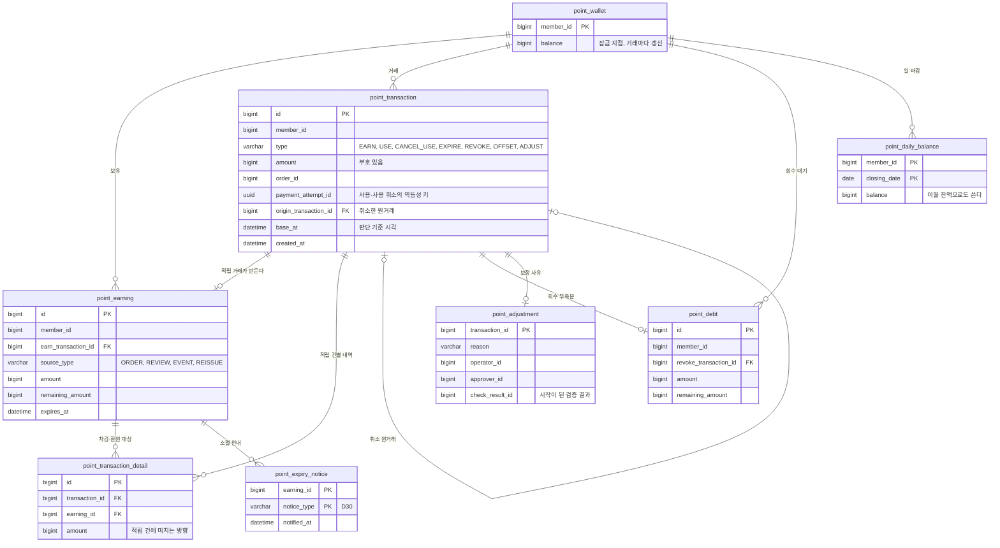

# 2부 소멸과 정합성 검증

[1부](01-적립금-원장과-동시-사용.md)에서 원장, 적립 건, 거래 상세, 회원 잔액으로 적립금을 나눠 담았다. 2부는 이 구조를 운영하면서 생기는 문제를 다룬다. 대량 소멸, 배치가 늦을 때의 만료 판단, 세 값의 정합성 검증과 보정, 원장 보관, 소멸 예정 안내 순서다.

**2부 추가 상황 (가정)**

- 회원 1,000만 명, 적립 건은 평소 하루 30만 건이다.
- 만료일에 금액이 조금이라도 남아 있는 적립 건은 40%다. 평소 하루 소멸 대상은 약 12만 건이다.
- 작년 블랙프라이데이에는 이벤트 적립이 하루 300만 건 있었다. 올해 그날 소멸 대상은 약 120만 건이다.
- 소멸은 매일 0시에 처리한다. 쇼핑몰은 24시간 운영하고 새벽에도 결제가 들어온다.

> 같은 금액이 원장, 적립 건, 회원 잔액 세 곳에 있다. **원장이 진실이고 나머지는 파생값이다.** 모든 변경은 원장을 거치고, 검증은 세 곳이 맞는지 확인하는 일이다.

## 1. 소멸을 한 문장으로 끝내면

```sql
UPDATE point_earning
SET remaining_amount = 0
WHERE expires_at <= NOW() AND remaining_amount > 0;
```

### 데이터가 어긋난다

| 테이블 | 빠진 것 | 결과 |
| --- | --- | --- |
| 원장 | `EXPIRE` 거래가 쌓이지 않는다 | "적립금이 왜 줄었냐"는 문의에 답할 근거가 없다. 원장 합계와 적립 건 합계가 어긋난다 |
| 거래 상세 | 어느 적립 건에서 얼마가 소멸했는지 남지 않는다 | 소멸도 사용처럼 `(적립 건, 금액)`으로 남겨야 추적할 수 있다 |
| 회원 잔액 | `balance`가 줄지 않는다 | 화면에 소멸 전 잔액이 남고, 결제할 때 잔액 확인은 통과하는데 차감할 적립 건이 없다 |

소멸도 사용과 똑같은 **거래**로 다룬다. 적립 건 하나를 소멸시킬 때마다 네 테이블을 함께 바꾼다.

### 120만 행의 락을 오래 쥔다

`UPDATE`는 바꾸는 행마다 행 락을 걸고 트랜잭션이 끝날 때까지 놓지 않는다.

- **새벽 결제 실패:** 소멸 대상 회원이 결제하면 락을 기다리다 타임아웃이 난다. 회원 잔액까지 갱신하면 수십만 회원이 한꺼번에 잠긴다.
- **실패하면 전부 다시:** 99%까지 갔다가 실패하면 롤백에도 비슷한 시간이 걸리고 처음부터 다시 해야 한다.
- **복제 지연:** 큰 트랜잭션은 커밋된 뒤 복제본에 한꺼번에 반영되어 그동안 복제본이 뒤처진다.

### 회원 단위로 잘게 나눈다

1. 소멸 대상 회원을 조금씩(예: 500명, 가정) 가져온다.
2. **회원 1명 = 트랜잭션 1개**로 처리한다. 회원 잔액 잠금 → 만료 적립 건 소멸 → 원장과 거래 상세 기록 → 잔액 감소 → 커밋.
3. 락은 회원 1명분만, 수 밀리초 동안만 잡는다.

결제도 회원 잔액을 먼저 잠그므로 잠금 순서가 같다. 결제와 배치가 부딪혀도 한쪽이 잠깐 기다릴 뿐 데드락은 없다. 중간에 죽어도 `remaining_amount > 0` 조건 덕분에 이미 처리한 건은 건너뛰므로 다시 돌리면 된다.

## 2. 배치가 처리하기 전의 만료 적립금

잘게 나누니 120만 건 처리에 1시간이 걸린다. 0시 30분에 아직 배치 차례가 오지 않은 회원이 결제한다. 3월분은 0시에 만료됐지만 `remaining_amount`와 회원 잔액에는 남아 있다.

이걸 쓰게 두면 회사가 손해를 본다. 그보다 큰 문제는 **같은 조건인데 회원마다 결과가 다르다**는 것이다. 배치가 먼저 처리한 회원은 0시 1분에 못 쓰고, 늦게 처리한 회원은 0시 59분에도 쓴다.

### 쓰기 전에 먼저 소멸시킨다

사용할 적립 건을 고를 때 `expires_at > 기준 시각`으로 거르면 된다. 그런데 1부에서 잔액 확인에 쓴 조건부 UPDATE(`balance >= 800`)는 이 시간대에 틀린다. `balance`에 만료된 금액이 섞여 있어서 확인은 통과하는데 실제로 차감할 금액이 모자란다.

| 방법 | 동작 | 특징 |
| --- | --- | --- |
| 잔액은 잠금에만 쓰기 | 회원 잔액은 잠금 지점으로만 쓰고, 사용 가능 금액은 유효한 적립 건 합계로 계산한다 | 한 회원의 적립 건은 적어 비용이 작다. 화면 잔액도 같은 방식으로 계산해야 한다 |
| 쓰기 전에 먼저 소멸 | 결제 트랜잭션에서 회원 잔액을 잠근 뒤 그 회원의 만료 적립 건을 **배치와 같은 로직으로** 먼저 소멸시키고 차감한다 | 회원 잔액이 항상 정확해져 조건부 UPDATE가 다시 유효하다 |

쓰기 전에 먼저 소멸시킨다. 그러면 배치는 제때 소멸시키는 주체가 아니라 **결제하지 않는 회원을 청소하는 역할**이 된다.

### 기준 시각은 서버가 한 번만 정한다

23:59:59에 시작한 결제가 00:00:01에 커밋되면 3월분을 쓸 수 있을까? 시작 시점 기준이 고객에게 납득된다. 다만 "시작"을 무엇으로 볼지 정해야 한다.

| 후보 | 문제 |
| --- | --- |
| 클라이언트가 보낸 시각 | 조작할 수 있다 |
| 결제 페이지에 들어온 시각 | 페이지를 열어 두면 만료를 몇 시간이고 미룰 수 있다 |
| 서버가 사용 요청을 받은 시각 | 서버가 정하므로 믿을 수 있다 |

1부의 결제 흐름에서는 적립금 차감이 PG 승인보다 먼저 첫 번째 트랜잭션에서 끝나므로, PG 승인이 0시를 넘겨도 문제가 없다. 차감 트랜잭션이 락을 기다리다 0시를 넘기는 경우에 대비해, 서버가 요청을 받을 때 **기준 시각을 한 번 정해 `base_at`에 남기고** 만료 판단과 원장 기록에 모두 그 값을 쓴다. 쿼리마다 `NOW()`를 부르면 한 트랜잭션 안에서도 판단 시각이 달라질 수 있다.

## 3. 세 값이 맞는지 검증하기

### 거래 1건 = 트랜잭션 1개

적립이든 차감이든 거래 1건은 네 테이블을 한 트랜잭션에서 바꾸고 한 번 커밋한다. **회원 잔액을 맨 처음에 잠그고 맨 마지막에 갱신한다.**

| 단계 | 적립 1,000원 | 사용 1,500원 |
| --- | --- | --- |
| 1 | `point_wallet` 잠금 | `point_wallet` 잠금, 만료분 먼저 소멸 |
| 2 | 원장에 `EARN +1,000` | 원장에 `USE -1,500` |
| 3 | 적립 건 생성 (`remaining 1,000`) | 만료 임박 순으로 적립 건 차감 |
| 4 | 거래 상세 `(새 적립 건, +1,000)` | 거래 상세 `(3월분, -1,000)`, `(6월분, -500)` |
| 5 | `balance += 1,000` | `balance -= 1,500` |
| 6 | 커밋 | 커밋 |

거래 상세의 `amount` 부호는 **적립 건에 미치는 방향**으로 통일한다. 사용, 소멸, 회수는 `-`, 적립과 환원은 `+`다.

### 어긋나는 경로는 규칙 밖에 있다

정상 흐름에서는 세 값이 어긋나지 않는다. 어긋나는 것은 이 규칙을 벗어날 때다.

- **규칙을 빼먹은 새 기능:** 운영자 수동 지급 기능이 적립 건만 넣고 원장과 잔액을 빠뜨린다.
- **DB 직접 수정:** 장애 대응 중에 `remaining_amount`만 고친다.
- **저장소 분리:** 잔액을 Redis에 따로 두면 DB 커밋과 Redis 갱신이 한 트랜잭션이 아니다.
- **빠진 거래 유형:** 회수 대기를 다음 적립에서 상계하면 적립 건과 잔액이 줄어드는데 기록할 유형이 없었다. `OFFSET` 거래를 추가했다.

| 검증식 | 의미 |
| --- | --- |
| `balance` = Σ `point_earning.remaining_amount` | 회원 잔액과 적립 건이 맞는다 |
| `balance` = Σ `point_transaction.amount` | 회원 잔액과 원장이 맞는다 |
| 적립 건마다 Σ `point_transaction_detail.amount` = `remaining_amount` | 적립 건 하나하나의 남은 금액에 근거가 있다 |

### 바뀐 것만 매일, 전체는 매달

다 썼거나 만료된 적립 건은 `remaining_amount`가 0이라 첫 번째 식에서 빼도 된다. 하지만 세 번째 식에서 빼면 **잘못 0이 된 적립 건을 닫힌 건이라는 이유로 검사하지 않게** 된다. 그래서 기준을 "닫혔는가"가 아니라 "바뀌었는가"로 잡는다.

| 방법 | 동작 | 잡는 것 |
| --- | --- | --- |
| 오늘 거래가 생긴 회원만 | 그날 원장에 거래가 쌓인 회원만 세 식으로 검사한다 | 정상 경로의 버그. 닫힌 적립 건도 사용 취소로 다시 열리면 그 회원에게 거래가 생겨 함께 잡힌다 |
| 일 마감 잔액 | 회원별 마감 잔액을 날마다 저장하고 `어제 마감 + 오늘 거래 합계 = 지금 balance`로 비교한다 | 원장 전체를 처음부터 합산하지 않는다 |
| 전체 총합 | `Σ 모든 balance = Σ 모든 원장 amount` 숫자 하나를 비교한다 | 어딘가 틀렸다는 사실을 빠르게 안다. 이 총액은 회계상 부채로 보고하는 미사용 적립금이기도 하다 |

| 주기 | 범위 | 실행 위치 |
| --- | --- | --- |
| 매일 | 오늘 거래가 생긴 회원 + 전체 총합 | 복제본 |
| 매월 | 전체 회원. DB 직접 수정처럼 거래 없이 생긴 어긋남을 잡는다 | 복제본, 한가한 시간 |

## 4. 어긋났을 때 고치기

매일 검사에서 한 회원의 `balance`와 적립 건 합계는 5,000원, 원장 합계는 4,200원이 나왔다.

원장이 단일 진실 원천이다. 원장은 추가만 하고 행마다 사유, 주문, 시각이 남아 근거가 있다. 하지만 이 숫자만으로는 원장이 기록을 빠뜨렸는지, 적립 건과 잔액이 기록 없이 바뀌었는지 알 수 없다. 적립 건별 검사로 근거 없는 적립 건을 찾아 800원이 어디서 왔는지부터 조사한다.

### `UPDATE`가 아니라 보정 거래로

`UPDATE balance = 4200`으로 맞추면 원장에 기록되지 않은 변경을 한 번 더 하는 셈이다. 원인과 똑같은 일이다. 회계에서 틀린 기록을 지우지 않고 수정 기록을 쌓듯, 원장에 `ADJUST` 거래를 추가하고 평소 거래와 같은 경로로 처리한다.

| 조사 결과 | 보정 | 결과 |
| --- | --- | --- |
| 정당한 지급인데 원장만 빠졌다 | 원장에 `ADJUST +800`을 추가하고 기존 적립 건에 연결한다. 적립 건과 잔액은 그대로 둔다 | 세 값 모두 5,000 |
| 부당하게 생긴 800원이다 | ① 실제로 일어난 변경을 `ADJUST +800`으로 먼저 기록하고 ② `ADJUST -800`으로 되돌린다. 되돌릴 때 적립 건과 잔액도 줄인다 | 세 값 모두 4,200. 무슨 일이 있었는지 원장에 남는다 |

**원장은 실제로 일어난 일을 기록한다.** 기록 없이 일어난 일도 먼저 기록하고 되돌린다. 고객이 그 800원을 이미 썼다면 [1부의 적립 회수](01-적립금-원장과-동시-사용.md#_4-적립-회수) 문제가 되며, 회사의 실수이므로 보통 손실로 처리한다.

보정 거래에는 사유, 처리한 운영자, 승인자, 시작이 된 검증 결과를 함께 남긴다. 자동으로 고치지 않고 사람이 원인을 확인한 뒤 보정하며, 원인이 된 버그도 고친다.

## 5. 원장 보관

하루 원장 100만 행, 상세 200만 행이 쌓인다고 가정하면 1년에 원장 3.65억 행, 상세 7.3억 행이다.

### 먼저 느려지는 것

행 수보다 **많은 행을 훑는 작업**이 먼저 느려진다. 인덱스로 몇 행만 찾는 조회는 B-tree 깊이가 로그로만 늘어 크게 느려지지 않는다.

| 작업 | 원장이 커질 때 | 이유 |
| --- | --- | --- |
| 결제, 취소 | 거의 그대로 | 주문 1건, 회원 1명의 남은 적립 건만 찾는다 |
| 고객 최근 내역 | 거의 그대로 | `(member_id, created_at)` 인덱스로 최근 20건만 읽는다 |
| 고객의 오래된 내역 | 느려진다 | 깊은 페이지로 갈수록 앞의 행을 다 건너뛴다 |
| 검증의 원장 합계 | 가장 먼저 느려진다 | 회원의 거래를 처음부터 전부 더한다. 매월 전체 검사는 수억 행을 훑는다 |
| 운영 작업 | 느려진다 | `ALTER`, 백업과 복구, 메모리에 다 들어가지 않는 인덱스 |

### 날짜 + 닫힘 기준으로 옮긴다

월별 파티션으로 나눠 오래된 달을 통째로 아카이브 저장소로 옮긴다. 다만 날짜가 오래됐다고 끝난 거래는 아니다.

| 옮기면 안 되는 것 | 다시 읽는 흐름 |
| --- | --- |
| 아직 취소될 수 있는 사용 거래와 상세 | 사용 취소는 원래 거래의 상세를 보고 적립 건에 되돌린다 |
| 아직 닫히지 않은 적립 건을 만든 거래와 상세 | 유효기간이 긴 이벤트 적립이나 재발급이 있을 수 있다 |
| 회수 대기가 남은 회수 거래 | 다음 적립에서 상계할 때 연결한다 |
| 분쟁이나 조사 중인 거래 | 보정 거래가 원거래를 가리킨다 |

컷오프는 **최대 유효기간 + 최대 취소 가능 기간**보다 충분히 지난 달로 잡고, 그래도 열려 있는 예외 건은 남겨 둔다.

### 이월 잔액

원장의 앞부분을 떼어 내면 `balance = Σ 원장`이 깨진다. 옮기기 전에 컷오프 시점의 회원별 잔액을 **이월 잔액**으로 남긴다. 장부를 마감할 때 기초 잔액을 넘기는 것과 같다.

> `balance = 이월 잔액 + Σ 컷오프 이후 원장`

일 마감 잔액을 그대로 이월 잔액으로 쓴다. 검증도 최근 원장만 더하면 되어 가장 먼저 느려지던 작업이 함께 해결된다.

아카이브한 원장도 법정 보관 기간 동안 지우지 않는다. 전자상거래법의 대금결제 기록 5년, 상법의 상업장부 10년 등이 근거가 될 수 있으니 법무와 확인이 필요하다. 고객 화면은 최근 2년(가정)만 보여 주고 그 이전은 별도 요청으로 아카이브에서 조회한다.

## 6. 소멸 예정 안내

마이페이지에 "30일 안에 소멸 예정: 1,200원"을 보여 주고, 매일 아침 소멸 예정 적립금이 있는 회원에게 알림을 한 번 보낸다.

### 화면 금액

`balance`는 전체 잔액이라 소멸 예정 금액이 아니다. 적립 건에서 구한다.

```sql
SELECT SUM(remaining_amount)
FROM point_earning
WHERE member_id = ?
  AND remaining_amount > 0
  AND expires_at > :base_at
  AND expires_at <= :base_at + INTERVAL 30 DAY;
```

1부에서 만든 `(member_id, expires_at)` 인덱스를 그대로 쓴다. `expires_at > :base_at`으로 배치가 아직 처리하지 않은 만료분을 뺀다.

### 알림은 적립 건 단위로 기록한다

알림을 보낸 뒤 회원이 적립금을 쓰면 실제 소멸 금액은 안내보다 줄어든다. 고객에게 불리하지 않으므로 괜찮다. 알림 문구에 "○월 ○일 기준"을 넣어 그 시점 금액임을 밝힌다.

더 조심할 것은 **알림이 빠지는 경우**다. 매일 "정확히 30일 뒤에 만료되는 적립 건"만 찾으면, 1부 정책 C처럼 30일짜리로 재발급된 적립 건이 그날 배치가 지난 뒤 생기면 다음 날부터는 대상 날짜가 지나 영영 안내받지 못한다. 7일짜리라면 처음부터 대상이 아니다.

그래서 날짜 하나가 아니라 **"30일 안에 만료되는데 아직 안내하지 않은 적립 건"**을 찾고, 안내 여부를 적립 건마다 기록한다.

1. `remaining_amount > 0`, `expires_at <= 기준 시각 + 30일`이고 `point_expiry_notice`에 행이 없는 적립 건을 찾는다.
2. 회원별로 묶어 알림 1건으로 만든다.
3. 한 트랜잭션에서 적립 건마다 `point_expiry_notice(earning_id, notice_type)` 행과 아웃박스 행을 쓴다.
4. 아웃박스 릴레이가 알림을 보낸다.

`(earning_id, notice_type)` 유니크 제약이 **중복 안내를 막는다.** 배치를 다시 돌려도 이미 안내한 적립 건은 건너뛴다. 아웃박스는 안내 기록과 발송 요청을 함께 커밋해 **빠짐없이 보내는 것**을 보장한다. 다만 릴레이는 최소 한 번 전달이라 같은 메시지를 다시 보낼 수 있으므로, 알림 ID를 발송 대행사에 멱등성 키로 넘긴다.

## 최종 데이터 모델



| 제약·인덱스 | 목적 |
| --- | --- |
| `point_transaction (payment_attempt_id, type)` 유니크 | 같은 결제 시도의 사용과 사용 취소가 두 번 쌓이지 않게 한다 |
| `point_transaction (order_id)` 유니크, `type = 'EARN'`일 때만 | 같은 주문의 구매 적립이 두 번 쌓이지 않게 한다 |
| `point_transaction (origin_transaction_id)` 유니크 | 한 거래에 취소가 두 번 쌓이지 않게 한다 |
| `point_transaction (member_id, created_at)` | 고객 내역 조회와 매일 검사 대상 회원 찾기 |
| `point_earning (member_id, expires_at)` | 결제할 때 만료 임박 순 선택, 소멸 예정 금액 |
| `point_earning (expires_at)` | 소멸 배치와 소멸 안내 대상 찾기 |
| `point_expiry_notice (earning_id, notice_type)` PK | 같은 적립 건의 중복 안내를 막는다 |

결제 시도 상태와 아웃박스는 적립금 바깥의 테이블이며, 각각 `payment_attempt_id`와 알림 ID로 연결된다.

## 남은 질문

- [ ] 회원이 탈퇴하면 남은 적립금과 원장은 어떻게 하는가? 개인정보 파기와 원장 보관 의무가 부딪힌다.
- [ ] 적립률이나 유효기간 정책이 바뀌면 이미 쌓인 적립 건은 어떻게 다루는가?
- [ ] 거래량이 커져 원장을 샤딩해야 한다면 샤드 키는 무엇인가? 회원 단위 잠금과 어떻게 맞물리는가?
- [ ] 알림 발송이 실패하거나 대행사가 느려질 때 아웃박스 릴레이는 어떻게 재시도하고 언제 포기하는가?

설계하며 판단이 갈린 질문은 [설계 질문 목록](부록-설계-질문-목록.md)에 모았다.

## 참고 자료

- [Designing Data-Intensive Applications](https://dataintensive.net/) 11장 스트림 처리: 이벤트 로그를 진실 원천으로 두고 파생 데이터를 만드는 관점
- [Transactional outbox 패턴](https://microservices.io/patterns/data/transactional-outbox.html): DB 변경과 메시지 발행을 함께 커밋하는 방법
- [수평 확장 2부 DB 확장과 샤딩](../02-수평-확장과-무상태-설계/02-DB-확장과-샤딩.md): 파티셔닝과 샤딩의 차이
