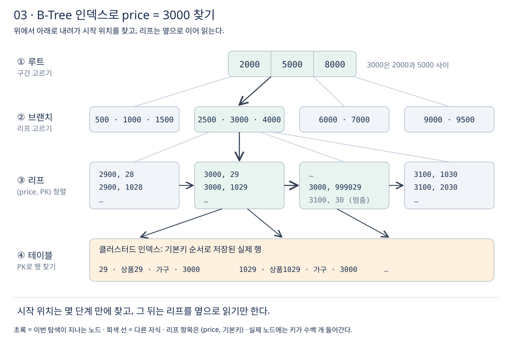

# 3장 인덱스 기초

데이터가 적을 때는 어떤 쿼리든 빠르다. 행이 백만 건을 넘으면 같은 쿼리가 수 초씩 걸리기 시작하고, 이때 가장 먼저 꺼내는 도구가 인덱스다. 이번 장에서는 **인덱스가 왜 빠른지, 어떤 조건에서 쓰이고 어떤 조건에서 쓰이지 않는지**를 정리한다. 강의 섹션 8에 해당한다. [MySQL의 인덱스 사용](https://dev.mysql.com/doc/refman/8.4/en/mysql-indexes.html)

## 1. 실습용 샘플 데이터

인덱스의 효과는 데이터가 많아야 보인다. 상품 테이블에 100만 건을 넣고 실습한다. 강의의 샘플 데이터와 컬럼은 다를 수 있으며, 이 노트는 쇼핑몰 상품 데이터로 통일한다.

```sql
CREATE TABLE product (
    product_id     BIGINT AUTO_INCREMENT PRIMARY KEY,
    name           VARCHAR(100) NOT NULL,
    category       VARCHAR(20)  NOT NULL,
    price          INT          NOT NULL,
    stock_quantity INT          NOT NULL,
    created_at     DATETIME     NOT NULL
);

-- 재귀 CTE의 기본 반복 한도는 1000이므로 이 세션에서만 늘린다
SET SESSION cte_max_recursion_depth = 1000000;

INSERT INTO product (name, category, price, stock_quantity, created_at)
WITH RECURSIVE seq (n) AS (
    SELECT 1 UNION ALL SELECT n + 1 FROM seq WHERE n < 1000000
)
SELECT CONCAT('상품', n),
       ELT(n % 5 + 1, '도서', '가전', '의류', '식품', '가구'),
       (n % 1000 + 1) * 100,
       n % 300,
       '2024-01-01' + INTERVAL (n % 730) DAY
FROM seq;
```

재귀 CTE는 기본으로 1000단계까지만 반복하므로 `cte_max_recursion_depth`를 늘린다. [WITH 절](https://dev.mysql.com/doc/refman/8.4/en/with.html)

## 2. 인덱스가 필요한 이유

인덱스가 없는 컬럼으로 찾으면 **MySQL은 첫 행부터 마지막 행까지 전부 읽으면서 조건에 맞는지 확인한다.** 이것을 풀 테이블 스캔(full table scan)이라고 하며, 테이블이 클수록 비용이 커진다. [MySQL의 인덱스 사용](https://dev.mysql.com/doc/refman/8.4/en/mysql-indexes.html)

```sql
EXPLAIN SELECT * FROM product WHERE name = '상품500000';
```

실행 계획의 `type`이 `ALL`이면 풀 테이블 스캔이다. `rows`에는 약 100만이 나온다. 찾는 상품은 한 건인데 100만 건을 읽는 셈이다. [풀 테이블 스캔 피하기](https://dev.mysql.com/doc/refman/8.4/en/table-scan-avoidance.html)

**풀 테이블 스캔의 비용은 데이터 양에 비례해 늘어난다.** 오늘 0.3초인 쿼리가 1년 뒤 데이터가 열 배가 되면 3초가 된다. 인덱스를 쓰면 데이터가 늘어도 찾는 비용이 아주 조금만 늘어난다. 실행 계획을 읽는 자세한 방법은 [성능 최적화 강의](../02-성능-최적화/공부%20목표.md)에서 다룬다.

## 3. 인덱스 소개

책 뒤의 찾아보기를 떠올리면 된다. 단어가 가나다순으로 정렬돼 있고 옆에 쪽 번호가 적혀 있어서, 책 전체를 넘기지 않고 원하는 쪽으로 바로 간다. **인덱스는 컬럼 값을 정렬해서 따로 저장하고, 각 값 옆에 실제 행을 찾아갈 정보를 붙여 둔 구조다.** [인덱스와 최적화](https://dev.mysql.com/doc/refman/8.4/en/optimization-indexes.html)

`price` 컬럼에 인덱스를 만들면 개념상 다음과 같은 정렬된 목록이 하나 더 생긴다.

```text
price 인덱스                 product 테이블
(price, product_id)          (product_id 순서로 저장)
 100,  1000                   1  상품1  가전  200 ...
 100,  2000                   2  상품2  의류  300 ...
 100,  3000          ──→      ...
 200,     1
 200,  1001
 ...
```

InnoDB에서 기본키가 아닌 컬럼의 인덱스(세컨더리 인덱스)는 **인덱스 컬럼 값과 그 행의 기본키 값**을 함께 저장한다. 인덱스에서 기본키를 얻은 다음, 기본키로 실제 행을 다시 찾는다. 이 구조는 [성능 최적화 강의](../02-성능-최적화/공부%20목표.md)의 클러스터드·세컨더리 인덱스에서 깊게 다룬다. [클러스터드·세컨더리 인덱스](https://dev.mysql.com/doc/refman/8.4/en/innodb-index-types.html)

인덱스는 공짜가 아니다. **정렬된 사본을 하나 더 두는 것이므로 저장 공간을 쓰고, INSERT·UPDATE·DELETE 때마다 인덱스도 함께 고쳐야 한다.** 이 비용은 [4장](04-인덱스-활용.md)의 단점과 주의사항에서 다시 본다. [인덱스와 최적화](https://dev.mysql.com/doc/refman/8.4/en/optimization-indexes.html)

## 4. 트리 자료 구조

정렬된 값을 빠르게 찾는 방법으로 이진 탐색이 있다. 하지만 DB는 값을 계속 넣고 지우므로, 정렬된 배열을 그대로 유지하기 어렵다. 그래서 **정렬을 유지하면서 넣고 지우기도 빠른 트리 구조**를 쓴다. MySQL의 일반 인덱스(PRIMARY KEY, UNIQUE, INDEX)는 대부분 B-Tree에 저장된다. [MySQL의 인덱스 사용](https://dev.mysql.com/doc/refman/8.4/en/mysql-indexes.html)



B-Tree의 특징은 다음과 같다.

- **모든 리프가 같은 깊이에 있다.** 어떤 값을 찾든 루트에서 리프까지 같은 단계 수로 내려간다.
- **노드 하나가 디스크 페이지 하나이고, 한 페이지에 키가 수백 개 들어간다.** InnoDB의 기본 페이지 크기는 16KB다. 자식이 수백 개씩 갈라지므로 행이 수백만 건이어도 트리 높이는 몇 단계에 그친다. [innodb_page_size](https://dev.mysql.com/doc/refman/8.4/en/innodb-parameters.html#sysvar_innodb_page_size)
- **리프에 값이 정렬돼 있고 옆 리프로 이어진다.** 그래서 시작 위치만 찾으면 범위 검색과 정렬을 그대로 순서대로 읽어서 처리한다.

해시 인덱스는 값 하나를 찾는 데는 빠르지만 `=`, `<=>` 비교에만 쓸 수 있고, 범위 검색이나 ORDER BY에는 쓸 수 없다. InnoDB 테이블의 일반 인덱스는 B-Tree다. [B-Tree와 해시 인덱스 비교](https://dev.mysql.com/doc/refman/8.4/en/index-btree-hash.html)

InnoDB가 실제로 쓰는 B+Tree의 내부 구조와 페이지 분할은 [성능 최적화 강의](../02-성능-최적화/공부%20목표.md)의 섹션 7에서 다룬다.

## 5. 인덱스 생성, 조회, 삭제

```sql
-- 생성: 두 문장은 같은 일을 한다
CREATE INDEX idx_product_price ON product (price);
ALTER TABLE product ADD INDEX idx_product_name (name);

-- 조회
SHOW INDEX FROM product;

-- 삭제
DROP INDEX idx_product_price ON product;
```

`CREATE INDEX`는 내부적으로 `ALTER TABLE`로 바뀌어 실행된다. 기본키는 `CREATE INDEX`로 만들 수 없고 `ALTER TABLE`로 만든다. [CREATE INDEX](https://dev.mysql.com/doc/refman/8.4/en/create-index.html), [DROP INDEX](https://dev.mysql.com/doc/refman/8.4/en/drop-index.html)

**기본키와 UNIQUE 제약은 따로 만들지 않아도 인덱스가 함께 생긴다.** `SHOW INDEX`를 실행하면 `PRIMARY`라는 이름의 인덱스가 이미 있다. 출력에서 자주 보는 컬럼은 다음과 같다. [SHOW INDEX](https://dev.mysql.com/doc/refman/8.4/en/show-index.html)

- `Key_name`: 인덱스 이름. 기본키는 항상 `PRIMARY`.
- `Seq_in_index`: 여러 컬럼 인덱스에서 이 컬럼이 몇 번째인지. 1부터 시작한다.
- `Non_unique`: 0이면 중복을 허용하지 않는 인덱스.
- `Cardinality`: 인덱스에 들어 있는 서로 다른 값 개수의 **추정치**. `ANALYZE TABLE`로 갱신한다.

인덱스 이름은 `idx_테이블_컬럼`처럼 규칙을 정해 두면, 실행 계획의 `key`만 보고 어떤 인덱스인지 알 수 있다.

## 6. 인덱스와 동등 비교

```sql
CREATE INDEX idx_product_name ON product (name);

EXPLAIN SELECT * FROM product WHERE name = '상품500000';
```

인덱스를 만든 뒤 같은 쿼리를 다시 보면 `type`이 `ref`, `key`가 `idx_product_name`, `rows`가 1로 바뀐다. **트리를 따라 내려가 '상품500000'이 있는 리프만 읽기 때문이다.** [EXPLAIN 출력 형식](https://dev.mysql.com/doc/refman/8.4/en/explain-output.html)

동등 비교의 `type`은 인덱스 종류에 따라 다르다. [EXPLAIN 출력 형식](https://dev.mysql.com/doc/refman/8.4/en/explain-output.html)

- `const`: 기본키나 UNIQUE 인덱스의 모든 컬럼을 상수와 `=`로 비교. 결과는 최대 한 행.
- `ref`: 중복을 허용하는 인덱스를 `=`로 비교. 결과가 여러 행일 수 있다.

### 타입이 다르면 인덱스를 못 쓸 수 있다

**문자열 컬럼을 숫자와 비교하면 인덱스를 쓰지 못한다.** 숫자 1은 문자열 '1', ' 1', '01' 모두와 같다고 판단될 수 있어서, 인덱스에서 한 위치를 찾아갈 수 없기 때문이다. [MySQL의 인덱스 사용](https://dev.mysql.com/doc/refman/8.4/en/mysql-indexes.html)

```sql
-- 회원 전화번호가 VARCHAR 컬럼이라면
SELECT * FROM member WHERE phone = 01012345678;    -- 인덱스를 못 씀
SELECT * FROM member WHERE phone = '01012345678';  -- 인덱스를 씀
```

JPA나 MyBatis에서 파라미터 타입을 컬럼 타입과 맞춰야 하는 이유이기도 하다.

## 7. 인덱스와 범위 검색

```sql
EXPLAIN SELECT * FROM product WHERE price BETWEEN 10000 AND 10500;
```

`price`에 인덱스가 있으면 `type`이 `range`가 된다. **트리에서 시작 값 10000의 위치를 찾고, 리프를 옆으로 따라가며 10500을 넘을 때까지 읽는다.** `>`, `>=`, `<`, `<=`, `BETWEEN`이 모두 이렇게 처리된다. [B-Tree 인덱스의 특징](https://dev.mysql.com/doc/refman/8.4/en/index-btree-hash.html#btree-index-characteristics), [범위 최적화](https://dev.mysql.com/doc/refman/8.4/en/range-optimization.html)

범위가 넓으면 인덱스가 있어도 쓰지 않을 수 있다. `price > 100`처럼 거의 모든 행이 해당하면, 인덱스로 한 건씩 기본키를 따라가며 행을 찾는 것보다 테이블을 처음부터 순서대로 읽는 편이 빠르다고 옵티마이저가 판단한다. [풀 테이블 스캔 피하기](https://dev.mysql.com/doc/refman/8.4/en/table-scan-avoidance.html) 이 판단은 [4장](04-인덱스-활용.md)에서 다시 본다.

### 컬럼을 가공하면 범위로 바꿀 수 없다

**인덱스 컬럼에 함수나 연산을 씌우면, 정렬된 인덱스에서 시작 위치를 찾을 수 없다.** 인덱스에는 `created_at` 값이 정렬돼 있지 `YEAR(created_at)` 값이 정렬돼 있지 않기 때문이다. 범위 검색은 인덱스 컬럼을 상수와 비교하는 조건에서 만들어진다. [범위 최적화](https://dev.mysql.com/doc/refman/8.4/en/range-optimization.html)

```sql
-- 인덱스를 못 씀
SELECT * FROM product WHERE YEAR(created_at) = 2025;
SELECT * FROM product WHERE price * 1.1 > 50000;

-- 컬럼은 그대로 두고 상수 쪽을 바꾸면 인덱스를 씀
SELECT * FROM product WHERE created_at >= '2025-01-01' AND created_at < '2026-01-01';
SELECT * FROM product WHERE price > 50000 / 1.1;
```

꼭 가공한 값으로 찾아야 한다면 **같은 식으로 함수 기반 인덱스를 만든다.** 이때 쿼리의 식이 인덱스의 식과 똑같아야 쓰인다. [함수 기반 인덱스](https://dev.mysql.com/doc/refman/8.4/en/create-index.html#create-index-functional-key-parts)

## 8. 인덱스와 LIKE 범위 검색

**`LIKE`는 와일드카드(`%`, `_`)로 시작하지 않을 때만 인덱스를 쓴다.** `LIKE '상품12%'`는 내부적으로 `'상품12' <= name < '상품13'` 같은 범위로 바뀌어 처리된다. [B-Tree 인덱스의 특징](https://dev.mysql.com/doc/refman/8.4/en/index-btree-hash.html#btree-index-characteristics)

```sql
SELECT * FROM product WHERE name LIKE '상품12%';    -- 인덱스 범위 검색
SELECT * FROM product WHERE name LIKE '%12';        -- 풀 스캔
SELECT * FROM product WHERE name LIKE '%상품12%';   -- 풀 스캔
```

전화번호부에서 '김'으로 시작하는 사람은 '김' 부분만 펼치면 되지만, 이름이 '수'로 끝나는 사람은 처음부터 끝까지 봐야 하는 것과 같다. 앞부분을 모르면 정렬된 인덱스에서 시작 위치를 정할 수 없다.

상품명 중간의 단어로 찾는 검색이 필요하다면 LIKE로 해결하지 말고 전문 검색(FULLTEXT) 인덱스나 별도 검색 엔진을 검토한다. [전문 검색 함수](https://dev.mysql.com/doc/refman/8.4/en/fulltext-search.html)

## 9. 인덱스와 정렬

인덱스는 이미 정렬돼 있다. **ORDER BY 컬럼이 인덱스 순서와 같으면 MySQL은 따로 정렬하지 않고 인덱스를 순서대로 읽는다.** [ORDER BY 최적화](https://dev.mysql.com/doc/refman/8.4/en/order-by-optimization.html)

```sql
-- price 인덱스를 순서대로 읽고 20건에서 멈춤
SELECT product_id, name, price FROM product ORDER BY price LIMIT 20;

-- 인덱스가 없는 컬럼으로 정렬: 전부 읽어 정렬한 뒤 20건을 고름
SELECT product_id, name, price FROM product ORDER BY stock_quantity LIMIT 20;
```

인덱스로 정렬하지 못하면 실행 계획의 `Extra`에 `Using filesort`가 나온다. 조건에 맞는 행을 모두 모아 따로 정렬하는 추가 단계가 있다는 뜻이다. **데이터가 많을수록 filesort 비용이 커지고, LIMIT 20이어도 전체를 정렬해야 한다.** [EXPLAIN 출력 형식](https://dev.mysql.com/doc/refman/8.4/en/explain-output.html)

- `ORDER BY price DESC`: 인덱스를 거꾸로 읽으면 되므로 인덱스를 쓴다.
- `ORDER BY ABS(price)`: 가공한 값은 인덱스 순서와 다르므로 filesort.
- `WHERE category = '도서' ORDER BY price`: `category`로 찾는 인덱스와 정렬할 인덱스가 다르면 filesort. 두 조건을 함께 해결하는 방법은 [4장](04-인덱스-활용.md)의 복합 인덱스에서 다룬다.

정렬 순서가 인덱스와 맞아도 `SELECT *`처럼 인덱스에 없는 컬럼을 많이 읽는다면, 옵티마이저는 인덱스를 따라 행을 하나씩 찾는 것보다 전체를 읽고 정렬하는 편을 고를 수 있다. LIMIT이 작을수록 인덱스 정렬이 유리하다. [ORDER BY 최적화](https://dev.mysql.com/doc/refman/8.4/en/order-by-optimization.html)

## 이해를 확인할 질문

1. 인덱스가 없을 때 100만 건 중 한 건을 찾는 쿼리는 왜 데이터가 늘수록 느려지는가?
2. B-Tree 인덱스가 범위 검색과 정렬에 유리한 이유를 리프 구조로 설명할 수 있는가?
3. `WHERE YEAR(created_at) = 2025`를 인덱스를 쓰는 조건으로 바꿔 쓸 수 있는가?
4. `LIKE '상품%'`는 인덱스를 쓰고 `LIKE '%상품'`은 못 쓰는 이유는 무엇인가?
5. 실행 계획에 `Using filesort`가 나오면 무슨 뜻인가?

관련 문서: [2장 뷰](02-뷰.md), [4장 인덱스 활용](04-인덱스-활용.md), [공부 목표](공부%20목표.md).
