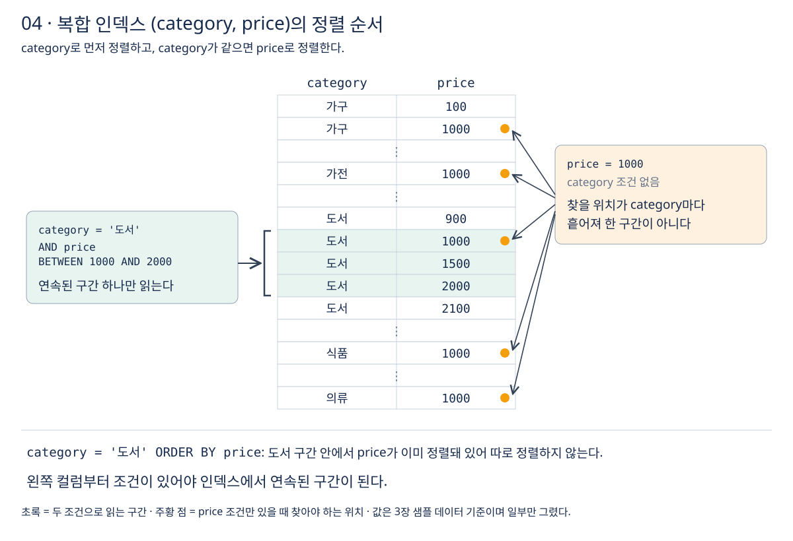

# 4장 인덱스 활용

3장에서 인덱스 하나가 동등 비교, 범위 검색, 정렬에 어떻게 쓰이는지 봤다. 실제 쿼리는 조건이 여러 개이고, 인덱스도 여러 개다. 이번 장에서는 **옵티마이저가 인덱스를 고르는 방식, 커버링 인덱스와 복합 인덱스, 그리고 인덱스를 설계하는 기준과 비용**을 정리한다. 강의 섹션 9에 해당한다.

예시는 [3장](03-인덱스-기초.md)의 상품 테이블(`product`, 100만 건)을 그대로 쓴다.

## 1 옵티마이저와 인덱스 선택

같은 결과를 얻는 방법은 여러 가지다. 풀 테이블 스캔을 할 수도, 인덱스 A나 B를 쓸 수도 있다. **옵티마이저는 각 방법의 예상 비용을 계산해 가장 싸다고 판단한 방법을 고른다.** 인덱스가 있다고 반드시 쓰는 것은 아니다. [MySQL의 인덱스 사용](https://dev.mysql.com/doc/refman/8.4/en/mysql-indexes.html)

```sql
CREATE INDEX idx_product_category ON product (category);
CREATE INDEX idx_product_price    ON product (price);

EXPLAIN SELECT * FROM product WHERE category = '도서' AND price = 5000;
```

실행 계획의 `possible_keys`에는 쓸 수 있는 인덱스 두 개가 모두 나오고, `key`에는 실제로 고른 하나가 나온다. 옵티마이저의 판단 기준은 다음과 같다.

- **더 적은 행으로 좁혀 주는 인덱스를 고른다.** `category`는 값이 다섯 종류라 '도서'가 약 20만 건이지만, `price = 5000`은 약 1000건이다. 이 경우 `idx_product_price`가 유리하다. [MySQL의 인덱스 사용](https://dev.mysql.com/doc/refman/8.4/en/mysql-indexes.html)
- **너무 많은 행이 해당하면 인덱스를 버리고 풀 테이블 스캔을 고른다.** 인덱스로 찾은 행마다 기본키로 실제 행을 다시 찾아야 하므로, 해당 행이 많으면 테이블을 순서대로 한 번 읽는 편이 빠르다. [풀 테이블 스캔 피하기](https://dev.mysql.com/doc/refman/8.4/en/table-scan-avoidance.html)
- **판단 근거는 통계 정보다.** 인덱스의 값 분포를 추정한 통계가 실제와 크게 다르면 잘못 고를 수 있다. 이때는 `ANALYZE TABLE product;`로 통계를 갱신한다.

이렇게 **한 인덱스로 걸러 낼 수 있는 행의 비율을 선택도(selectivity)라고 하고, 선택도가 높은 인덱스일수록 쓸모가 크다.** 성별이나 상태값처럼 값 종류가 적은 컬럼은 단독 인덱스로는 효과가 작다. [MySQL 용어집: cardinality](https://dev.mysql.com/doc/refman/8.4/en/glossary.html#glos_cardinality)

옵티마이저가 비용을 계산하는 방식, 통계와 히스토그램, 인덱스 힌트는 [성능 최적화 강의](../02-성능-최적화/공부%20목표.md)의 섹션 12에서 다룬다.

## 2 커버링 인덱스

3장에서 본 것처럼 세컨더리 인덱스로 찾으면 **인덱스에서 기본키를 얻고, 그 기본키로 실제 행을 한 번 더 찾는다.** 찾은 행이 많으면 이 두 번째 탐색이 비용의 대부분을 차지한다. [클러스터드·세컨더리 인덱스](https://dev.mysql.com/doc/refman/8.4/en/innodb-index-types.html)

**쿼리에 필요한 컬럼이 모두 인덱스 안에 있으면 실제 행을 찾아가지 않고 인덱스만 읽고 끝낸다.** 이런 인덱스를 커버링 인덱스(covering index)라고 한다. 실행 계획의 `Extra`에 `Using index`가 나오면 커버링 인덱스로 처리했다는 뜻이다. [MySQL의 인덱스 사용](https://dev.mysql.com/doc/refman/8.4/en/mysql-indexes.html), [EXPLAIN 출력 형식](https://dev.mysql.com/doc/refman/8.4/en/explain-output.html)

```sql
-- price 인덱스에는 price와 기본키(product_id)가 들어 있다
SELECT product_id, price FROM product WHERE price BETWEEN 10000 AND 20000;  -- Using index

-- name은 인덱스에 없으므로 행마다 실제 행을 찾아간다
SELECT product_id, name, price FROM product WHERE price BETWEEN 10000 AND 20000;
```

InnoDB의 세컨더리 인덱스에는 기본키가 항상 들어 있으므로, `product_id`는 따로 넣지 않아도 커버링에 포함된다. **`SELECT *`는 커버링 인덱스를 거의 쓸 수 없게 만든다.** 화면에 필요한 컬럼만 고르는 습관이 커버링 인덱스의 출발점이다.

커버링 인덱스를 대용량 데이터에서 측정하는 실습은 [성능 최적화 강의](../02-성능-최적화/공부%20목표.md)의 섹션 10에서 한다.

## 3 복합 인덱스

여러 컬럼을 묶어 만든 인덱스를 복합 인덱스(composite index)라고 한다. 최대 16개 컬럼까지 묶을 수 있다. **복합 인덱스는 첫 번째 컬럼으로 정렬하고, 첫 번째 값이 같으면 두 번째 컬럼으로, 그다음 세 번째 컬럼으로 정렬한 목록이다.** [복합 인덱스](https://dev.mysql.com/doc/refman/8.4/en/multiple-column-indexes.html)

```sql
CREATE INDEX idx_product_category_price ON product (category, price);
```



### 왼쪽 컬럼부터 써야 한다

전화번호부가 (성, 이름) 순서로 정렬돼 있다고 생각하면 된다. '김'씨를 찾거나 '김철수'를 찾기는 쉽지만, 이름이 '철수'인 사람은 성을 모르면 처음부터 다 봐야 한다. **복합 인덱스는 왼쪽 컬럼부터 차례로 조건이 있을 때만 탐색에 쓸 수 있다.** (a, b, c) 인덱스는 (a), (a, b), (a, b, c) 조건에 쓰인다. [복합 인덱스](https://dev.mysql.com/doc/refman/8.4/en/multiple-column-indexes.html)

```sql
-- (category, price) 인덱스를 탐색에 씀
WHERE category = '도서'
WHERE category = '도서' AND price = 5000
WHERE price = 5000 AND category = '도서'   -- WHERE에 쓴 순서는 상관없음

-- 탐색에 못 씀
WHERE price = 5000                          -- 첫 컬럼 조건이 없음
WHERE category = '도서' OR price = 5000     -- OR로 묶인 price 쪽을 인덱스로 찾을 수 없음
```

**WHERE 절에 조건을 쓰는 순서는 상관없다.** 중요한 것은 인덱스를 만들 때 정한 컬럼 순서다.

MySQL 8.4는 첫 컬럼 조건이 없어도 첫 컬럼의 값 종류가 적으면 값마다 건너뛰며 찾는 스킵 스캔(skip scan)을 쓰기도 한다. 조건이 까다로운 예외이므로, 설계는 왼쪽 컬럼부터 쓰는 규칙을 기준으로 한다. 스킵 스캔은 [성능 최적화 강의](../02-성능-최적화/공부%20목표.md)의 섹션 10에서 다룬다. [범위 최적화: 스킵 스캔](https://dev.mysql.com/doc/refman/8.4/en/range-optimization.html#range-access-skip-scan)

### 범위 조건 뒤의 컬럼은 탐색에 쓰이지 않는다

**앞 컬럼이 `=`로 비교될 때만 다음 컬럼까지 탐색 범위를 좁힌다. 앞 컬럼이 범위 조건(`>`, `<`, `BETWEEN`, `LIKE '...%'`)이면 그 뒤 컬럼은 탐색 범위를 정하는 데 쓰지 않는다.** [범위 최적화: 복합 인덱스](https://dev.mysql.com/doc/refman/8.4/en/range-optimization.html#range-access-multi-part)

```sql
CREATE INDEX idx_product_price_category ON product (price, category);

-- price는 범위, category는 탐색 범위를 좁히는 데 못 씀
SELECT * FROM product WHERE price BETWEEN 10000 AND 20000 AND category = '도서';
```

`price`로 정렬된 인덱스에서 10000~20000 구간 안의 `category`는 '가구', '가전', '도서'... 가 뒤섞여 있다. 그래서 MySQL은 구간 전체를 읽으면서 '도서'만 골라낸다. 같은 쿼리에 `(category, price)` 인덱스를 쓰면 '도서' 구간 안에서 `price`가 정렬돼 있으므로 정확히 필요한 부분만 읽는다. **등호 조건 컬럼을 앞에, 범위 조건 컬럼을 뒤에 둔다.**

### 복합 인덱스와 정렬

복합 인덱스의 정렬 순서를 그대로 쓰면 WHERE와 ORDER BY를 한 인덱스로 함께 처리한다. 3장에서 filesort가 났던 쿼리가 여기서 해결된다. [ORDER BY 최적화](https://dev.mysql.com/doc/refman/8.4/en/order-by-optimization.html)

```sql
-- (category, price) 인덱스: '도서' 구간 안에서 price가 이미 정렬돼 있음
SELECT product_id, name, price FROM product
WHERE category = '도서'
ORDER BY price
LIMIT 20;
```

반대로 다음은 인덱스로 정렬하지 못하고 filesort가 난다.

- `WHERE category IN ('도서', '가전') ORDER BY price`: 두 구간을 합치면 price 순서가 아니다.
- `WHERE price > 10000 ORDER BY category`: 정렬 컬럼이 인덱스 순서와 다르다.
- `ORDER BY category ASC, price DESC`: 방향이 섞여 있다. 인덱스도 같은 방향 조합(`category ASC, price DESC`)으로 만들면 쓸 수 있다.

### 복합 인덱스 규칙 정리

- 왼쪽 컬럼부터 조건이 있어야 탐색에 쓴다.
- 등호 조건 컬럼을 앞에, 범위 조건 컬럼을 뒤에 둔다.
- 범위 조건이 나온 뒤의 컬럼은 탐색 범위를 줄이지 못한다.
- 등호 조건 다음 컬럼으로 ORDER BY하면 정렬을 생략한다.
- SELECT 컬럼까지 인덱스에 들어 있으면 커버링 인덱스가 된다.

## 4 인덱스 설계 가이드라인

다음은 공식 문서의 동작 규칙과 이 장의 내용을 바탕으로 정리한 기준이다. 정답 공식이 아니라 출발점이며, **최종 판단은 실행 계획과 실제 측정으로 한다.**

1. **실제로 자주 실행되는 쿼리에서 출발한다.** 컬럼마다 인덱스를 미리 만들지 않는다. 느린 쿼리와 자주 쓰는 화면의 WHERE, JOIN, ORDER BY를 먼저 본다.
2. **선택도가 높은 조건을 인덱스로 받는다.** 결과를 크게 줄이는 컬럼이 인덱스의 효과가 크다. 다만 복합 인덱스에서는 선택도보다 등호·범위 규칙이 먼저다.
3. **복합 인덱스의 컬럼 순서는 등호 조건, 정렬 컬럼, 범위 조건 순서를 먼저 검토한다.** 범위 조건과 정렬을 함께 만족시키기 어려울 때는 어느 쪽을 인덱스로 처리할지 실행 계획으로 비교한다.
4. **새로 만들기 전에 기존 인덱스를 늘릴 수 있는지 본다.** (category) 인덱스가 있는데 (category, price)를 만들면, (category) 조건은 새 인덱스로도 처리되므로 기존 것은 대부분 필요 없어진다.
5. **조인 컬럼에 인덱스를 둔다.** 주문 테이블의 `member_id`처럼 다른 테이블과 연결하는 컬럼은 조인할 때 인덱스로 찾는다. 외래 키를 걸면 MySQL이 이 인덱스를 자동으로 만든다([5장](05-데이터-무결성.md)). [MySQL의 인덱스 사용](https://dev.mysql.com/doc/refman/8.4/en/mysql-indexes.html)
6. **만든 뒤에는 실행 계획으로 실제로 쓰이는지 확인한다.** `key`가 기대한 인덱스인지, `Extra`에 `Using filesort`가 남았는지 본다.

## 5 인덱스의 단점과 주의사항

**인덱스는 읽기를 빠르게 하는 대신 쓰기와 공간에 비용을 낸다.** 공식 문서도 쿼리에 쓰이는 모든 컬럼에 인덱스를 만들고 싶은 유혹을 경계한다. [인덱스와 최적화](https://dev.mysql.com/doc/refman/8.4/en/optimization-indexes.html)

- **쓰기 비용**: INSERT, UPDATE, DELETE 때마다 관련된 모든 인덱스를 함께 고친다. 인덱스가 다섯 개인 테이블에 행 하나를 넣으면 인덱스 다섯 곳에도 값이 들어간다.
- **저장 공간**: 인덱스마다 정렬된 사본을 따로 둔다. 세컨더리 인덱스에는 기본키가 함께 들어가므로 **기본키가 길면 모든 세컨더리 인덱스가 커진다.** [클러스터드·세컨더리 인덱스](https://dev.mysql.com/doc/refman/8.4/en/innodb-index-types.html)
- **옵티마이저의 부담**: 인덱스가 많으면 어떤 인덱스를 쓸지 고르는 데도 시간이 들고, 잘못 고를 가능성도 생긴다.

주의할 사용 패턴은 3장과 이 장에서 본 것을 모으면 다음과 같다.

- 인덱스 컬럼을 함수나 연산으로 가공한다.
- 문자열 컬럼을 숫자와 비교하는 등 타입을 맞추지 않는다.
- `LIKE '%키워드'`처럼 와일드카드로 시작한다.
- 복합 인덱스의 첫 컬럼 조건이 없다.
- 인덱스 컬럼과 다른 컬럼을 OR로 묶는다.

### 인덱스를 안전하게 지우기

쓰지 않는 것 같은 인덱스를 바로 지웠다가 어떤 쿼리가 느려지면, 큰 테이블은 다시 만드는 데 오래 걸린다. MySQL 8.4에서는 **인덱스를 지우지 않고 옵티마이저에게만 보이지 않게 하는 보이지 않는 인덱스(invisible index)** 를 쓸 수 있다. 숨긴 상태로 지켜본 뒤 문제가 없으면 지우고, 문제가 생기면 바로 되돌린다. 기본키는 숨길 수 없다. [보이지 않는 인덱스](https://dev.mysql.com/doc/refman/8.4/en/invisible-indexes.html)

```sql
ALTER TABLE product ALTER INDEX idx_product_category INVISIBLE;
-- 지켜본 뒤
ALTER TABLE product ALTER INDEX idx_product_category VISIBLE;  -- 되돌리기
DROP INDEX idx_product_category ON product;                    -- 또는 삭제
```

숨겨도 인덱스는 계속 갱신되므로 쓰기 비용은 그대로 든다. 확인 기간을 정해 두고 결론을 낸다.

## 이해를 확인할 질문

1. 인덱스가 있는데도 옵티마이저가 풀 테이블 스캔을 고르는 것은 언제 합리적인가?
2. `SELECT product_id, price ... WHERE price ...`가 `price` 인덱스만으로 끝나는 이유는 무엇인가?
3. (category, price) 인덱스는 `WHERE price = 5000`에 왜 쓰이지 않는가?
4. `WHERE price BETWEEN ... AND category = '도서'`에는 (price, category)와 (category, price) 중 어느 인덱스가 나은가?
5. 인덱스를 지우기 전에 보이지 않는 인덱스로 먼저 확인하는 이유는 무엇인가?

관련 문서: [3장 인덱스 기초](03-인덱스-기초.md), [5장 데이터 무결성](05-데이터-무결성.md), [공부 목표](공부%20목표.md).
