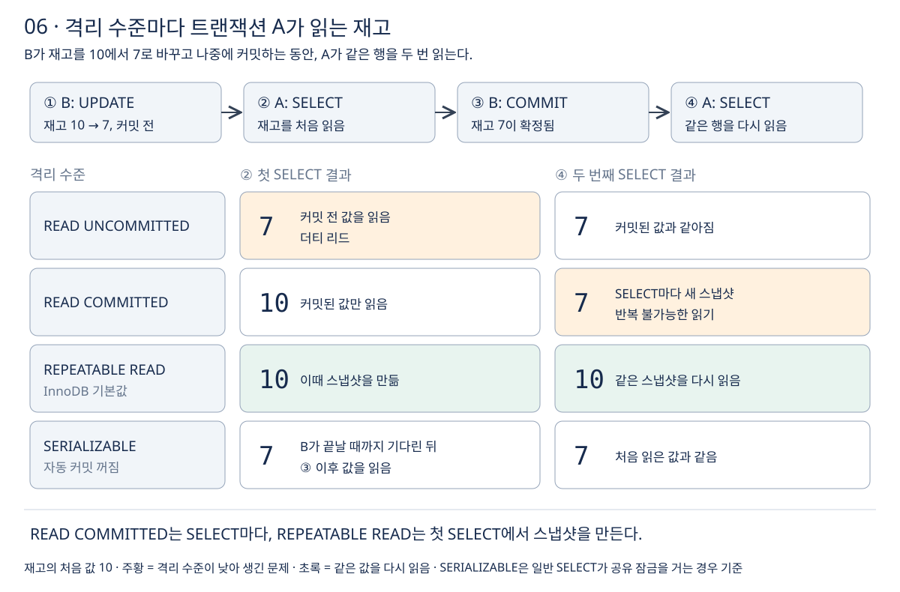

# 6장 트랜잭션

주문 한 건을 처리하려면 재고를 줄이고, 주문을 만들고, 포인트를 쓰는 여러 SQL이 필요하다. 이 SQL들이 **모두 반영되거나 하나도 반영되지 않게 묶는 단위가 트랜잭션**이다. 이번 장에서는 커밋과 롤백, ACID 속성, 그리고 여러 트랜잭션이 동시에 실행될 때 서로를 얼마나 보는지 정하는 격리 수준을 정리한다. 강의 섹션 11에 해당한다. [InnoDB와 ACID](https://dev.mysql.com/doc/refman/8.4/en/mysql-acid.html)

## 1 트랜잭션이 필요한 이유

회원 7번이 상품 1번을 3개 주문하고 포인트 1000점을 쓰는 과정이다.

```sql
UPDATE product SET stock_quantity = stock_quantity - 3 WHERE product_id = 1;
INSERT INTO orders (member_id, product_id, quantity, status, ordered_at)
VALUES (7, 1, 3, 'ORDERED', NOW());
UPDATE member SET point = point - 1000 WHERE member_id = 7;
```

두 번째 INSERT까지 성공하고 세 번째 UPDATE에서 서버가 죽거나 오류가 나면 어떻게 될까? 재고는 줄었고 주문도 생겼는데 포인트는 그대로다. **각 SQL은 성공했지만 데이터 전체로는 맞지 않는 상태가 남는다.**

**트랜잭션은 여러 SQL을 하나의 작업 단위로 묶어 "전부 반영" 아니면 "전부 취소"만 일어나게 한다.** 중간 상태는 남지 않는다. 동시에 실행되는 다른 트랜잭션이 이 작업의 중간 상태를 보지 않게 하는 것도 트랜잭션의 역할이다.

## 2 커밋과 롤백

```sql
START TRANSACTION;

UPDATE product SET stock_quantity = stock_quantity - 3 WHERE product_id = 1;
INSERT INTO orders (member_id, product_id, quantity, status, ordered_at)
VALUES (7, 1, 3, 'ORDERED', NOW());
UPDATE member SET point = point - 1000 WHERE member_id = 7;

COMMIT;    -- 세 변경을 확정
-- ROLLBACK; 이었다면 세 변경을 모두 취소
```

**`COMMIT`은 트랜잭션의 변경을 확정해 다른 세션도 볼 수 있게 하고, `ROLLBACK`은 트랜잭션의 변경을 모두 취소한다.** [START TRANSACTION, COMMIT, ROLLBACK](https://dev.mysql.com/doc/refman/8.4/en/commit.html)

### 자동 커밋

**MySQL은 기본으로 자동 커밋(autocommit) 모드다.** `START TRANSACTION` 없이 실행한 SQL은 한 문장이 곧 하나의 트랜잭션이어서, 실행이 끝나면 바로 커밋된다. 그래서 나중에 `ROLLBACK`으로 되돌릴 수 없다. 여러 문장을 묶으려면 `START TRANSACTION`으로 시작한다. 그러면 `COMMIT`이나 `ROLLBACK`까지 자동 커밋이 꺼져 있다가, 트랜잭션이 끝나면 원래대로 돌아온다. [START TRANSACTION, COMMIT, ROLLBACK](https://dev.mysql.com/doc/refman/8.4/en/commit.html)

Spring의 `@Transactional`도 결국 DB 연결의 자동 커밋을 끄고, 메서드가 끝나면 커밋하거나 예외가 나면 롤백하는 방식이다. 자세한 동작은 [트랜잭션과 데이터 정합성](../../03-트랜잭션과-데이터-정합성/공부%20목표.md)에서 다룬다.

### 오류가 나도 트랜잭션 전체가 롤백되지는 않는다

**InnoDB는 오류가 난 문장만 롤백하고 트랜잭션은 열린 채로 두는 경우가 많다.** 중복 키 오류나 잠금 대기 시간 초과가 나면 그 문장만 취소된다. 트랜잭션 전체를 자동으로 롤백하는 것은 교착 상태(deadlock) 같은 경우다. [InnoDB 오류 처리](https://dev.mysql.com/doc/refman/8.4/en/innodb-error-handling.html)

그래서 **오류가 나면 앱이 직접 `ROLLBACK`을 해야 한다.** 오류를 무시하고 `COMMIT`하면 성공한 문장만 반영되어, 1절의 맞지 않는 상태가 그대로 생긴다.

### 묵시적 커밋

`CREATE TABLE`, `ALTER TABLE`, `DROP TABLE` 같은 DDL은 **실행 전에 진행 중이던 트랜잭션을 자동으로 커밋한다.** 트랜잭션 안에서 DDL을 실행하면 그 앞의 변경은 롤백할 수 없게 된다. [묵시적 커밋을 일으키는 문장](https://dev.mysql.com/doc/refman/8.4/en/implicit-commit.html)

## 3 ACID 속성

트랜잭션이 지켜야 하는 네 가지 성질의 머리글자다. [InnoDB와 ACID](https://dev.mysql.com/doc/refman/8.4/en/mysql-acid.html)

- **원자성(Atomicity)**: 트랜잭션의 변경은 전부 반영되거나 전부 취소된다. 1절의 문제를 막는 성질이다. InnoDB는 변경 전 값을 undo 로그에 남겨 두었다가 롤백할 때 되돌린다.
- **일관성(Consistency)**: 트랜잭션 전후로 데이터가 정해진 규칙을 지킨다. 재고가 음수가 되지 않고, 주문이 없는 회원을 가리키지 않는다. [5장](05-데이터-무결성.md)의 제약 조건이 이 규칙을 DB에서 지킨다.
- **격리성(Isolation)**: 동시에 실행되는 트랜잭션이 서로의 중간 상태에 영향을 받지 않는다. 얼마나 엄격하게 떼어 놓을지를 격리 수준으로 정한다(4절).
- **지속성(Durability)**: 커밋된 변경은 서버가 죽어도 사라지지 않는다. InnoDB는 커밋할 때 redo 로그를 디스크에 기록해 지킨다.

MySQL 문서는 일관성을 "장애가 나도 데이터가 깨지지 않도록 하는 InnoDB 내부 처리"(doublewrite 버퍼, 장애 복구) 쪽에서 설명한다. 일반적인 교재는 "제약 조건 같은 규칙을 지키는 것"으로 설명하는 경우가 많으니 둘 다 알아 둔다. undo 로그, redo 로그, doublewrite 버퍼의 동작은 [3장 InnoDB 아키텍처](../02-성능-최적화/03-데이터베이스-성능과-MySQL-아키텍처/03-InnoDB-아키텍처.md)에 정리했다.

## 4 트랜잭션 격리 수준

트랜잭션을 완전히 떼어 놓으려면 하나씩 순서대로 실행하면 된다. 하지만 그러면 동시에 처리할 수 있는 양이 크게 준다. **격리 수준은 동시 처리 성능과 데이터를 정확하게 보는 정도 사이의 균형을 정하는 설정이다.** InnoDB는 SQL 표준의 네 가지 격리 수준을 모두 지원하고, **기본값은 REPEATABLE READ다.** [트랜잭션 격리 수준](https://dev.mysql.com/doc/refman/8.4/en/innodb-transaction-isolation-levels.html)

### 격리 수준이 낮을 때 생기는 문제

- **더티 리드(dirty read)**: 다른 트랜잭션이 아직 커밋하지 않은 변경을 읽는다. 그 트랜잭션이 롤백하면 존재한 적 없는 값을 읽은 셈이다. [MySQL 용어집: dirty read](https://dev.mysql.com/doc/refman/8.4/en/glossary.html#glos_dirty_read)
- **반복 불가능한 읽기(non-repeatable read)**: 같은 트랜잭션에서 같은 행을 두 번 읽었는데, 그사이 다른 트랜잭션이 커밋해서 값이 다르다. [MySQL 용어집: non-repeatable read](https://dev.mysql.com/doc/refman/8.4/en/glossary.html#glos_non_repeatable_read)
- **팬텀 읽기(phantom read)**: 같은 조건으로 두 번 조회했는데, 그사이 다른 트랜잭션이 넣은 행이 두 번째 결과에 새로 나타난다. [팬텀 행](https://dev.mysql.com/doc/refman/8.4/en/innodb-next-key-locking.html)

### 네 가지 격리 수준

아래로 갈수록 격리가 엄격하다. 각 항목은 다른 트랜잭션의 변경이 보이는 시점과 생길 수 있는 문제다.

- **READ UNCOMMITTED**: 커밋 전 변경도 보인다. 더티 리드, 반복 불가능한 읽기, 팬텀이 모두 생길 수 있다.
- **READ COMMITTED**: 커밋되면 다음 SELECT부터 보인다. 반복 불가능한 읽기와 팬텀이 생길 수 있다.
- **REPEATABLE READ (기본값)**: 첫 SELECT 시점의 스냅샷만 본다. SQL 표준에서는 팬텀을 허용한다.
- **SERIALIZABLE**: 읽기에도 잠금을 걸어 순서를 정한다. 세 문제가 생기지 않는 대신 대기가 늘어난다.

같은 상황에서 격리 수준마다 무엇을 읽는지 그림으로 비교하면 다음과 같다. 상품 1번의 재고는 처음에 10이고, 트랜잭션 B가 재고를 7로 바꾼 뒤 나중에 커밋한다.



- **READ UNCOMMITTED**: 커밋하지 않은 7을 읽는다. B가 롤백하면 A는 존재하지 않은 값을 쓴 셈이 된다. [트랜잭션 격리 수준](https://dev.mysql.com/doc/refman/8.4/en/innodb-transaction-isolation-levels.html)
- **READ COMMITTED**: **SELECT마다 새 스냅샷을 만든다.** 첫 SELECT는 커밋된 10, B가 커밋한 뒤의 SELECT는 7이다. 같은 트랜잭션 안에서 값이 바뀐다.
- **REPEATABLE READ**: **트랜잭션의 첫 SELECT가 만든 스냅샷을 끝까지 쓴다.** 두 번 모두 10이다. 최신 값을 보려면 커밋하고 새 트랜잭션에서 읽는다. [일관된 읽기](https://dev.mysql.com/doc/refman/8.4/en/innodb-consistent-read.html)
- **SERIALIZABLE**: 자동 커밋이 꺼져 있으면 InnoDB가 일반 SELECT를 `SELECT ... FOR SHARE`로 바꿔 잠금을 건다. B가 고치고 있는 행이므로 A는 B가 끝날 때까지 기다린 뒤 7을 읽는다.

READ COMMITTED와 REPEATABLE READ의 SELECT는 잠금을 걸지 않고 스냅샷을 읽는다. 이것을 일관된 읽기(consistent read)라고 하며, **읽는 쪽과 쓰는 쪽이 서로 기다리지 않아서 동시 처리 성능이 좋다.** [일관된 읽기](https://dev.mysql.com/doc/refman/8.4/en/innodb-consistent-read.html)

### InnoDB의 REPEATABLE READ와 팬텀

SQL 표준에서 REPEATABLE READ는 팬텀을 허용한다. InnoDB에서는 사정이 조금 다르다.

- **일반 SELECT**: 첫 SELECT의 스냅샷을 계속 읽으므로, 다른 트랜잭션이 나중에 넣은 행은 보이지 않는다.
- **잠금을 거는 읽기(`SELECT ... FOR UPDATE`)와 UPDATE, DELETE**: 스냅샷이 아니라 최신 데이터를 읽는다. 범위 조건이면 넥스트 키 잠금(next-key lock)으로 범위 사이에 새 행이 들어오는 것을 막는다. [트랜잭션 격리 수준](https://dev.mysql.com/doc/refman/8.4/en/innodb-transaction-isolation-levels.html), [팬텀 행](https://dev.mysql.com/doc/refman/8.4/en/innodb-next-key-locking.html)

여기서 주의할 점이 생긴다. **같은 REPEATABLE READ 트랜잭션 안에서도 일반 SELECT는 옛 스냅샷을, UPDATE는 최신 값을 본다.** 그림에서 A가 SELECT로 재고 10을 읽은 뒤 `UPDATE ... SET stock_quantity = stock_quantity - 1`을 하면, 최신 값 7에서 1을 뺀다. 공식 문서도 한 REPEATABLE READ 트랜잭션에서 잠금을 거는 문장과 일반 SELECT를 섞지 말라고 권한다. 읽은 값을 바탕으로 고쳐야 한다면 처음부터 `SELECT ... FOR UPDATE`로 읽는다. 잠금과 동시성 제어는 [트랜잭션과 데이터 정합성](../../03-트랜잭션과-데이터-정합성/공부%20목표.md)에서 이어서 본다.

### 격리 수준 확인과 변경

```sql
SELECT @@transaction_isolation;

-- 현재 세션의 이후 트랜잭션에 적용
SET SESSION TRANSACTION ISOLATION LEVEL READ COMMITTED;

-- 다음 트랜잭션 하나에만 적용
SET TRANSACTION ISOLATION LEVEL SERIALIZABLE;
```

`SESSION`이나 `GLOBAL`을 쓰지 않으면 **다음에 시작하는 트랜잭션 하나에만** 적용된다. `GLOBAL`은 이후에 새로 연결하는 세션에만 적용되고 이미 연결된 세션은 바뀌지 않는다. [SET TRANSACTION](https://dev.mysql.com/doc/refman/8.4/en/set-transaction.html)

## 이해를 확인할 질문

1. 자동 커밋 모드에서 UPDATE를 실행한 뒤 ROLLBACK을 하면 어떻게 되는가?
2. 트랜잭션 중간의 INSERT가 중복 키 오류로 실패했을 때, 앱이 해야 할 일은 무엇인가?
3. READ COMMITTED와 REPEATABLE READ는 스냅샷을 만드는 시점이 어떻게 다른가?
4. REPEATABLE READ에서 SELECT로 읽은 재고와 UPDATE가 계산에 쓰는 재고가 다를 수 있는 이유는 무엇인가?
5. 트랜잭션 안에서 ALTER TABLE을 실행하면 앞의 변경은 어떻게 되는가?

관련 문서: [5장 데이터 무결성](05-데이터-무결성.md), [공부 목표](공부%20목표.md), [트랜잭션과 데이터 정합성](../../03-트랜잭션과-데이터-정합성/공부%20목표.md).
