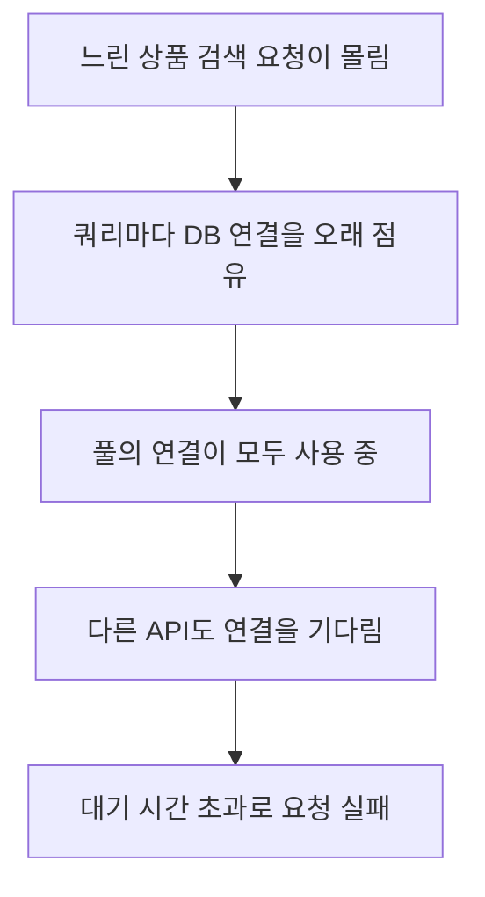

# 1장 성능의 중요성

개발할 때 0.1초에 끝나던 조회가 데이터가 쌓인 뒤 10초씩 걸리는 일은 드물지 않다. 이번 장에서는 **쿼리가 왜 데이터 양에 따라 느려지는지, 느린 쿼리 하나가 서비스 전체에 어떤 영향을 주는지, 원인을 무엇으로 찾고 증명하는지**를 정리한다. 강의 섹션 3의 11강에 해당한다.

## 1 데이터가 쌓이면 느려지는 쿼리

**같은 쿼리라도 읽어야 하는 데이터가 늘면 실행 시간도 늘어난다.** 조건에 맞는 인덱스가 없으면 MySQL은 첫 행부터 테이블 전체를 읽어 조건에 맞는 행을 찾는다. 테이블이 클수록 이 비용은 커진다. [MySQL 인덱스 사용 방식](https://dev.mysql.com/doc/refman/8.4/en/mysql-indexes.html)

다음은 상품 한 건을 이름으로 찾는 상황을 단순화한 비교다. 숫자는 이해를 위한 예시다.

| 상품 수 | 인덱스 없이 읽는 행 | 인덱스로 찾을 때 |
| --- | --- | --- |
| 1천 건 | 1천 건 | 트리 몇 단계만 내려감 |
| 500만 건 | 500만 건 | 트리 높이가 조금 늘어날 뿐 거의 같음 |

개발 환경의 테스트 데이터는 대개 적어서 두 방식의 차이가 드러나지 않는다. **운영 데이터가 쌓인 뒤에야 문제가 보이는 이유가 여기에 있다.** 인덱스가 트리 구조로 빠르게 찾는 원리는 섹션 7에서 다룬다.

## 2 느린 응답이 서비스에 주는 영향

**성능은 기술 지표이기 전에 사용자 경험과 매출에 영향을 주는 문제다.** 응답이 느리면 사용자는 기다리지 않고 떠난다. 쇼핑몰의 상품 목록이 10초 걸리면 그 사이 고객은 다른 곳에서 같은 상품을 찾는다. web.dev는 페이지 속도 개선이 이탈률과 전환율에 영향을 준 여러 사례를 정리하고 있다. [속도가 중요한 이유](https://web.dev/articles/why-speed-matters)

기능이 맞게 동작하는지와 충분히 빠르게 동작하는지는 별개의 질문이다. **결과가 정확해도 너무 늦게 나오면 사용자에게는 실패한 기능이다.**

## 3 느린 쿼리 하나가 서비스 전체를 늦추는 과정

DB는 여러 API와 서버가 함께 쓰는 공유 자원이다. 그래서 느린 쿼리의 피해는 그 쿼리를 쓰는 API에서 끝나지 않는다.

Spring 앱은 보통 커넥션 풀(HikariCP)에서 DB 연결을 빌려 쿼리를 실행한다. 쿼리가 오래 걸리면 그동안 연결을 돌려주지 못한다. 느린 요청이 몰리면 풀의 연결이 모두 빌려진 상태가 되고, 다른 요청은 빈 연결을 기다리다 `connectionTimeout`이 지나면 실패한다. [HikariCP 설정](https://github.com/brettwooldridge/HikariCP#gear-configuration-knobs-baby)

DB 서버 안에서도 느린 쿼리는 CPU, 디스크 I/O, 메모리 버퍼를 오래 차지한다. **평소에 빠르던 쿼리까지 함께 느려질 수 있다.** 이 흐름은 일반적인 구조를 단순화한 것이며, 실제 영향은 풀 크기와 타임아웃 설정, 트래픽에 따라 달라진다.

## 4 감이 아니라 근거로 원인 찾기

"인덱스를 하나 추가하면 빨라지겠지"라는 추측은 틀릴 수 있다. 원인을 찾고 개선을 증명하려면 측정값이 필요하다.

| 도구 | 알 수 있는 것 | 다루는 곳 |
| --- | --- | --- |
| 느린 쿼리 로그 | 기준 시간보다 오래 걸린 쿼리가 무엇인지 | 운영 진단 |
| EXPLAIN | 옵티마이저가 어떻게 실행할 계획인지 | 섹션 4 |
| EXPLAIN ANALYZE | 실제로 실행했을 때 단계별 시간과 행 수 | 섹션 5 |

느린 쿼리 로그는 실행 시간이 `long_query_time`초를 넘은 쿼리를 기록한다. 무엇이 느린지 찾는 출발점이다. [MySQL 느린 쿼리 로그](https://dev.mysql.com/doc/refman/8.4/en/slow-query-log.html) EXPLAIN은 쿼리를 실행하지 않고 계획만 보여 주지만, **EXPLAIN ANALYZE는 쿼리를 실제로 실행한다.** 운영 DB에서 무거운 쿼리에 함부로 쓰면 안 된다. [MySQL EXPLAIN](https://dev.mysql.com/doc/refman/8.4/en/explain.html)

개선을 주장할 때는 **같은 데이터와 같은 조건에서 개선 전후를 비교한 기록**을 남긴다. 캐시가 데워진 상태와 아닌 상태처럼 조건이 다르면 비교가 의미를 잃는다.

## 5 성능 개선에도 비용이 있다

인덱스는 조회를 빠르게 하지만 공짜가 아니다. 데이터를 넣고 고치고 지울 때마다 인덱스도 함께 갱신해야 하고, 저장 공간을 차지한다. 쓰지 않는 인덱스는 옵티마이저가 어떤 인덱스를 쓸지 판단하는 시간까지 늘린다. [MySQL 인덱스 최적화](https://dev.mysql.com/doc/refman/8.4/en/optimization-indexes.html)

**성능 최적화는 조회 속도, 쓰기 비용, 저장 공간 사이의 트레이드오프를 고르는 일이다.** 인덱스의 비용은 섹션 11에서 자세히 다룬다.

## 이해를 확인할 질문

1. 개발 환경에서 빠르던 쿼리가 운영에서 느려지는 이유는 무엇인가?
2. 상품 검색 쿼리 하나가 느린데 주문 API까지 실패하는 과정을 설명할 수 있는가?
3. EXPLAIN과 EXPLAIN ANALYZE는 운영 DB에서 쓸 때 어떤 차이가 있는가?
4. 인덱스를 많이 만들수록 좋지 않은 이유는 무엇인가?

관련 문서: [공부 목표](공부%20목표.md).
