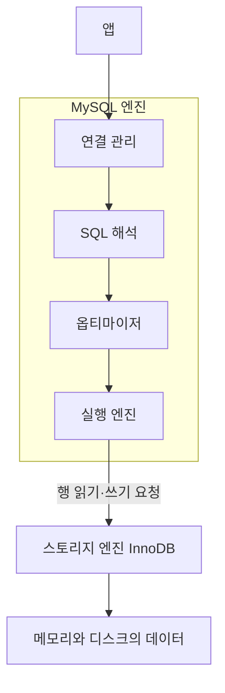

# 2장 MySQL 서버 구조

MySQL 서버는 크게 **SQL을 해석하고 실행 방법을 정하는 MySQL 엔진**과 **실제로 데이터를 저장하고 읽는 스토리지 엔진**으로 나뉜다. 이번 장에서는 두 계층이 하는 일과, 앱의 연결 하나가 서버 안에서 어떻게 다뤄지는지를 정리한다. 강의 섹션 3의 12강에 해당한다.

## 1 MySQL 엔진과 스토리지 엔진

**MySQL 엔진은 "무엇을 어떤 순서로 읽을지" 정하고, 스토리지 엔진은 "실제로 읽고 쓰는" 일을 한다.** 연결 관리, SQL 해석, 실행 계획 수립처럼 모든 테이블에 공통인 기능은 MySQL 엔진이 맡는다. 데이터를 디스크와 메모리에 어떤 형태로 저장할지는 스토리지 엔진이 맡는다. [MySQL 스토리지 엔진 구조](https://dev.mysql.com/doc/refman/8.4/en/pluggable-storage-overview.html)



스토리지 엔진은 교체할 수 있는 구조다. 그래서 이 구조를 **플러그형 스토리지 엔진 구조**라고 부른다. 앱은 어느 스토리지 엔진을 쓰든 같은 SQL로 MySQL에 요청한다. [MySQL 스토리지 엔진 구조](https://dev.mysql.com/doc/refman/8.4/en/pluggable-storage-overview.html)

### 두 계층 사이의 요청

실행 엔진은 스토리지 엔진에 "인덱스 순서로 다음 행을 달라", "테이블의 다음 행을 달라" 같은 요청을 한 행씩 보낸다. 이 요청 횟수는 `Handler_read_*` 상태 변수로 확인할 수 있다. [MySQL 상태 변수](https://dev.mysql.com/doc/refman/8.4/en/server-status-variables.html)

```sql
SHOW SESSION STATUS LIKE 'Handler_read%';
```

- `Handler_read_next`: 인덱스 순서로 다음 행을 읽을 때 늘어난다. 인덱스 범위 조회에서 나온다.
- `Handler_read_rnd_next`: 데이터 파일의 다음 행을 읽을 때 늘어난다. 테이블 스캔에서 나온다.

공식 문서는 `Handler_read_rnd_next` 값이 크면 테이블 스캔이 많다는 뜻이고, 인덱스가 맞지 않을 가능성이 있다고 설명한다. **쿼리 실행 전후로 이 값을 비교하면 스토리지 엔진에 몇 번 행을 요청했는지 숫자로 볼 수 있다.**

## 2 MySQL 엔진의 구성 요소

| 구성 요소 | 하는 일 |
| --- | --- |
| 연결 관리 | 클라이언트 연결을 받고 인증한 뒤, 연결을 처리할 스레드를 정한다 |
| SQL 해석 | 문법을 검사하고, 테이블·컬럼이 실제로 있는지와 권한을 확인한다 |
| 옵티마이저 | 인덱스 사용 여부, 조인 순서 등 가장 비용이 적은 실행 계획을 고른다 |
| 실행 엔진 | 실행 계획대로 스토리지 엔진에 요청하고, 받은 행을 조인·정렬·집계한다 |

**인덱스를 어떻게 쓸지는 옵티마이저가 정하지만, 인덱스 자체는 스토리지 엔진이 관리한다.** 이 구분은 섹션 10의 ICP(Index Condition Pushdown)를 이해할 때 다시 필요하다. 쿼리 한 건이 이 단계를 거치는 과정은 15강 쿼리 실행 흐름에서 이어서 다룬다.

## 3 연결과 스레드

MySQL은 클라이언트 연결마다 전용 스레드를 하나 배정한다. 이 스레드가 해당 연결의 인증과 요청 처리를 맡는다. 연결이 끝난 스레드는 바로 없애지 않고 **스레드 캐시**에 보관했다가 다음 연결에 다시 쓴다. 캐시 크기는 `thread_cache_size`로 정한다. [MySQL 연결 처리](https://dev.mysql.com/doc/refman/8.4/en/connection-interfaces.html)

| 구분 | MySQL | PostgreSQL |
| --- | --- | --- |
| 연결 하나에 배정 | 스레드 하나 | 프로세스 하나 |
| 재사용 | 스레드 캐시 | 없음, 연결마다 새 프로세스 |

PostgreSQL은 연결마다 백엔드 프로세스를 하나씩 만든다. 이 저장소의 실습 DB가 PostgreSQL이므로 차이를 알아 둔다. [PostgreSQL 연결 방식](https://www.postgresql.org/docs/17/connect-estab.html)

두 DB 모두 연결을 새로 만드는 데 비용이 든다. **Spring 앱이 HikariCP 같은 커넥션 풀로 연결을 미리 만들어 재사용하는 이유가 여기에 있다.** 1장에서 본 것처럼 풀의 연결이 모두 느린 쿼리에 묶이면 다른 요청도 기다린다.

연결이 아주 많을 때 스레드를 공유해 처리하는 스레드 풀은 MySQL 상용판(Enterprise Edition)의 기능이다. 커뮤니티판의 기본 방식은 연결당 스레드다. [MySQL Enterprise 스레드 풀](https://dev.mysql.com/doc/refman/8.4/en/thread-pool.html)

## 4 스토리지 엔진 확인과 InnoDB

```sql
SHOW ENGINES;
```

`Support` 값이 `DEFAULT`인 엔진이 기본 스토리지 엔진이다. MySQL 8.4의 기본값은 **InnoDB**다. InnoDB는 커밋·롤백, 장애 복구, 행 단위 잠금을 지원한다. 이 강의의 실습과 인덱스 구조 설명은 모두 InnoDB를 기준으로 한다. [MySQL 스토리지 엔진](https://dev.mysql.com/doc/refman/8.4/en/storage-engines.html)

스토리지 엔진은 테이블마다 정해진다. 그래서 **같은 SQL이라도 테이블의 스토리지 엔진에 따라 저장 방식과 성능 특성이 달라진다.** InnoDB의 내부 구조는 13강에서 다룬다.

## 5 사라진 쿼리 캐시

MySQL 5.7까지는 같은 SELECT 문의 결과를 저장해 두고 재사용하는 **쿼리 캐시**가 있었다. 8.0에서 이 기능이 제거되었다. [MySQL 8.0 변경 사항](https://dev.mysql.com/doc/refman/8.0/en/mysql-nutshell.html)

쿼리 캐시는 테이블이 조금만 바뀌어도 그 테이블과 관련된 캐시를 모두 무효화했다. 쓰기가 잦으면 캐시는 거의 쓰이지 못하고, 캐시를 관리하는 비용이 오히려 병목이 되었다. [MySQL 팀의 쿼리 캐시 제거 설명](https://dev.mysql.com/blog-archive/mysql-8-0-retiring-support-for-the-query-cache/)

**지금의 MySQL에서 같은 쿼리를 반복해도 결과를 그대로 꺼내 주는 장치는 없다.** 대신 InnoDB가 자주 읽는 데이터 페이지를 메모리에 올려 두는데, 이것은 결과가 아니라 데이터를 캐시하는 것이다. 결과 캐시가 필요하면 Redis 같은 앱 쪽 캐시를 쓴다.

## 이해를 확인할 질문

1. MySQL 엔진과 스토리지 엔진은 각각 무슨 일을 하는가?
2. 인덱스를 쓸지 정하는 쪽과 인덱스를 관리하는 쪽은 각각 어디인가?
3. MySQL과 PostgreSQL은 연결 하나를 어떻게 처리하는가? 앱이 커넥션 풀을 쓰는 이유는 무엇인가?
4. MySQL 8.0에서 쿼리 캐시가 사라진 이유는 무엇인가?

관련 문서: [1장 성능의 중요성](01-성능의-중요성.md), [공부 목표](공부%20목표.md).
