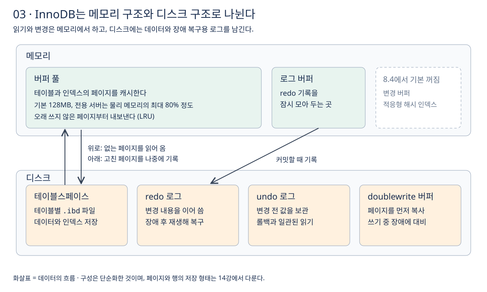
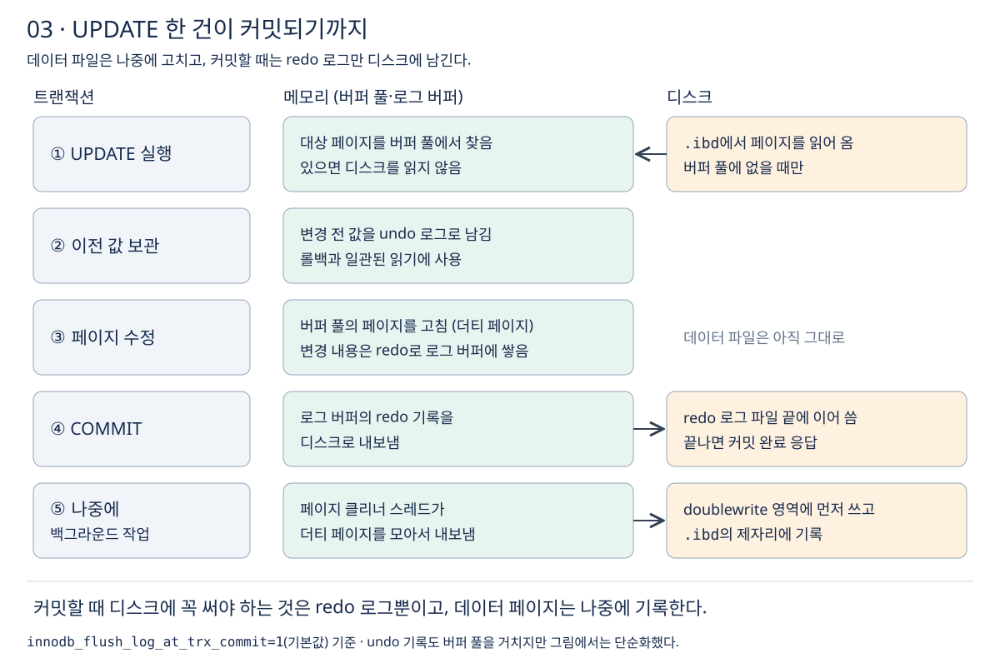

# 3장 InnoDB 아키텍처

2장에서 MySQL의 실제 데이터 저장은 스토리지 엔진이 맡고, 기본 스토리지 엔진은 InnoDB라는 것을 봤다. 이번 장에서는 InnoDB 안을 **메모리 구조와 디스크 구조**로 나눠 보고, **변경을 빠르게 처리하면서도 장애에 데이터를 잃지 않는 방법**을 정리한다. 강의 섹션 3의 13강에 해당한다.

## 1 메모리 구조와 디스크 구조

**InnoDB는 데이터를 읽고 고치는 일을 메모리에서 하고, 디스크에는 데이터와 장애 복구용 로그를 남긴다.** [InnoDB 구조](https://dev.mysql.com/doc/refman/8.4/en/innodb-architecture.html)



| 구성 요소 | 위치 | 하는 일 |
| --- | --- | --- |
| 버퍼 풀 | 메모리 | 테이블과 인덱스의 페이지를 캐시한다 |
| 로그 버퍼 | 메모리 | 디스크에 쓸 redo 기록을 잠시 모아 둔다 |
| 테이블스페이스 | 디스크 | 테이블의 데이터와 인덱스를 저장한다 |
| redo 로그 | 디스크 | 변경 내용을 기록해 장애 후 복구에 쓴다 |
| undo 로그 | 디스크 | 변경 전 값을 보관해 롤백과 일관된 읽기에 쓴다 |
| doublewrite 버퍼 | 디스크 | 페이지를 쓰는 도중 장애가 나도 온전한 사본을 남긴다 |

테이블스페이스는 기본적으로 테이블마다 파일 하나로 만들어진다. `orders` 테이블이면 `orders.ibd` 파일 하나에 데이터와 인덱스가 함께 들어간다. [테이블별 테이블스페이스](https://dev.mysql.com/doc/refman/8.4/en/innodb-file-per-table-tablespaces.html)

## 2 버퍼 풀

**버퍼 풀은 InnoDB가 테이블과 인덱스 데이터를 캐시하는 메모리 영역이다.** 자주 쓰는 데이터를 메모리에서 바로 읽으므로 디스크 읽기가 줄어든다. 데이터는 행 하나가 아니라 여러 행이 담긴 **페이지** 단위로 올라온다. [버퍼 풀](https://dev.mysql.com/doc/refman/8.4/en/innodb-buffer-pool.html)

크기는 `innodb_buffer_pool_size`로 정하며 기본값은 128MB다. DB만 돌리는 전용 서버에서는 물리 메모리의 최대 80% 정도를 버퍼 풀에 주는 경우가 많다. **기본값 128MB를 그대로 두면 데이터가 조금만 커져도 디스크 읽기가 늘어난다.** 운영 DB의 설정값을 꼭 확인한다. [버퍼 풀 크기 설정](https://dev.mysql.com/doc/refman/8.4/en/innodb-parameters.html#sysvar_innodb_buffer_pool_size)

### 자주 쓰는 페이지를 지키는 LRU

버퍼 풀이 가득 차면 오래 쓰지 않은 페이지부터 내보낸다. 이것을 LRU(Least Recently Used) 방식이라고 한다. 단순한 LRU라면 큰 테이블을 한 번 훑는 쿼리가 자주 쓰는 페이지를 모두 밀어낼 수 있다.

InnoDB는 이를 막기 위해 목록을 최근에 쓴 페이지 구역(new)과 덜 쓴 페이지 구역(old)으로 나눈다. 기본값으로 버퍼 풀의 3/8이 old 구역이다. **새로 읽은 페이지는 맨 앞이 아니라 old 구역의 앞쪽에 넣는다.** 한 번 읽고 다시 쓰지 않는 페이지는 old 구역에서 먼저 빠져나가고, 다시 읽힌 페이지만 new 구역으로 올라간다. [버퍼 풀 LRU](https://dev.mysql.com/doc/refman/8.4/en/innodb-buffer-pool.html)

### 버퍼 풀에서 얼마나 찾았는지 확인

```sql
SHOW GLOBAL STATUS LIKE 'Innodb_buffer_pool_read%';
```

- `Innodb_buffer_pool_read_requests`: 페이지를 읽으려 한 전체 횟수.
- `Innodb_buffer_pool_reads`: 그중 버퍼 풀에 없어 디스크에서 읽어야 했던 횟수.

**두 번째 값이 첫 번째 값에 비해 크게 늘면 버퍼 풀이 작거나, 큰 범위를 훑는 쿼리가 있다는 신호다.** [MySQL 상태 변수](https://dev.mysql.com/doc/refman/8.4/en/server-status-variables.html)

## 3 redo 로그: 빠르게 쓰고 안전하게 남기기

UPDATE를 실행하면 InnoDB는 데이터 파일을 바로 고치지 않는다. 버퍼 풀에 있는 페이지만 고친다. 이렇게 고쳤지만 아직 디스크에 쓰지 않은 페이지를 **더티 페이지**라고 한다. 더티 페이지는 나중에 페이지 클리너 스레드가 모아서 디스크에 기록한다. [버퍼 풀 플러시](https://dev.mysql.com/doc/refman/8.4/en/innodb-buffer-pool-flushing.html)

그러면 커밋 직후 서버가 죽으면 고친 내용이 사라지지 않을까? 이것을 막는 것이 **redo 로그**다. 변경 내용을 redo 로그에 먼저 기록하고, 장애 후 재시작할 때 이 기록을 다시 적용해 커밋된 변경을 되살린다. [redo 로그](https://dev.mysql.com/doc/refman/8.4/en/innodb-redo-log.html)



**커밋할 때 데이터 페이지 대신 redo 로그를 쓰는 이유는 쓰는 방식이 다르기 때문이다.** 고친 데이터 페이지들은 파일 여기저기에 흩어져 있어 여러 곳을 찾아가며 써야 한다. redo 로그는 파일 끝에 순서대로 이어 쓰기만 하면 된다. 흩어진 위치에 쓰는 랜덤 I/O와 이어 쓰는 순차 I/O의 비용 차이는 섹션 8에서 실습으로 확인한다.

### 커밋할 때 redo를 어디까지 쓸지

`innodb_flush_log_at_trx_commit` 설정이 커밋 때 redo 로그를 디스크에 얼마나 확실히 쓸지 정한다. [로그 버퍼](https://dev.mysql.com/doc/refman/8.4/en/innodb-redo-log-buffer.html), [설정값 설명](https://dev.mysql.com/doc/refman/8.4/en/innodb-parameters.html#sysvar_innodb_flush_log_at_trx_commit)

| 값 | 커밋 때 동작 | 장애 시 |
| --- | --- | --- |
| 1 (기본) | 커밋마다 디스크까지 기록 | 커밋된 변경을 잃지 않음 |
| 2 | 커밋마다 쓰되, 디스크 반영은 1초마다 | OS 장애·정전 때 최근 변경을 잃을 수 있음 |
| 0 | 쓰기와 디스크 반영 모두 1초마다 | 서버 장애만으로도 최근 변경을 잃을 수 있음 |

공식 문서는 완전한 ACID를 지키려면 기본값 1이 필요하다고 설명한다. **0이나 2로 바꾸면 쓰기가 빨라지는 대신 커밋했다고 응답한 데이터를 잃을 수 있다.**

## 4 undo 로그: 변경 전 값

**undo 로그는 트랜잭션이 고치기 전의 값을 보관한다.** 롤백하면 이 값으로 되돌린다. 다른 트랜잭션이 아직 커밋되지 않은 변경 대신 이전 값을 읽어야 할 때도 undo 로그를 쓴다. 이것이 일관된 읽기(consistent read)다. [undo 로그](https://dev.mysql.com/doc/refman/8.4/en/innodb-undo-logs.html)

그래서 **오래 열려 있는 트랜잭션은 성능 문제를 만든다.** 그 트랜잭션이 이전 값을 볼 수도 있으므로 InnoDB는 관련 undo 기록을 지우지 못하고, undo 영역이 계속 커진다. 공식 문서는 읽기만 하는 트랜잭션이라도 주기적으로 커밋하라고 권한다. [InnoDB 다중 버전](https://dev.mysql.com/doc/refman/8.4/en/innodb-multi-versioning.html) 트랜잭션과 격리 수준은 [트랜잭션과 데이터 정합성](../../../03-트랜잭션과-데이터-정합성/공부%20목표.md)에서 이어서 다룬다.

## 5 doublewrite 버퍼

페이지를 디스크에 쓰는 도중 서버나 OS, 저장 장치에 장애가 나면 페이지가 반만 써진 채 남을 수 있다. InnoDB는 이를 대비해 **더티 페이지를 데이터 파일의 제자리에 쓰기 전에 doublewrite 버퍼라는 영역에 먼저 쓴다.** 복구할 때 제자리의 페이지가 깨져 있으면 doublewrite 버퍼에서 온전한 사본을 찾는다. [doublewrite 버퍼](https://dev.mysql.com/doc/refman/8.4/en/innodb-doublewrite-buffer.html)

## 6 MySQL 8.4에서 기본으로 꺼진 기능

자료에 따라 InnoDB 메모리 구조에 다음 두 가지가 함께 나온다. MySQL 8.4에서는 둘 다 기본으로 꺼져 있다. 8.0과 기본값이 다르니 버전을 확인하고 읽는다. [MySQL 8.4 변경 사항](https://dev.mysql.com/doc/refman/8.4/en/mysql-nutshell.html)

- **변경 버퍼**: 버퍼 풀에 없는 세컨더리 인덱스 페이지의 변경을 모아 두었다가 나중에 반영한다. `innodb_change_buffering` 기본값이 8.0의 `all`에서 8.4의 `none`으로 바뀌었다. [변경 버퍼](https://dev.mysql.com/doc/refman/8.4/en/innodb-change-buffer.html)
- **적응형 해시 인덱스**: 자주 찾는 인덱스 값에 해시 인덱스를 자동으로 만들어 탐색을 줄인다. `innodb_adaptive_hash_index` 기본값이 8.0의 `ON`에서 8.4의 `OFF`로 바뀌었다. [적응형 해시 인덱스](https://dev.mysql.com/doc/refman/8.4/en/innodb-adaptive-hash.html)

## 이해를 확인할 질문

1. 버퍼 풀 기본값 128MB를 그대로 둔 운영 DB에서는 어떤 일이 생기는가?
2. 큰 테이블을 한 번 훑는 쿼리가 자주 쓰는 페이지를 밀어내지 않도록 InnoDB는 무엇을 하는가?
3. 커밋할 때 데이터 페이지를 바로 쓰지 않아도 데이터를 잃지 않는 이유는 무엇인가?
4. `innodb_flush_log_at_trx_commit`를 2로 바꾸면 무엇을 얻고 무엇을 잃는가?
5. 오래 열린 트랜잭션이 undo 로그에 어떤 영향을 주는가?

관련 문서: [2장 MySQL 서버 구조](02-MySQL-서버-구조.md), [공부 목표](../공부%20목표.md).
