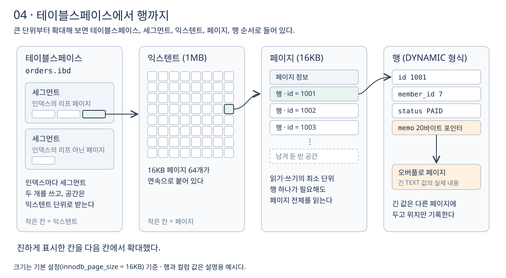

# 4장 데이터 저장 구조

3장에서 InnoDB가 데이터를 테이블스페이스 파일에 저장한다는 것을 봤다. 이번 장에서는 그 파일 안을 **테이블스페이스, 세그먼트, 익스텐트, 페이지, 행** 순서로 확대해 보고, 이 구조가 성능에 어떤 영향을 주는지 정리한다. 강의 섹션 3의 14강에 해당한다.

## 1. 저장 단위

**InnoDB가 디스크와 메모리 사이에서 데이터를 주고받는 단위는 행이 아니라 페이지다.** 페이지 크기는 기본 16KB이고, 한 MySQL 인스턴스의 모든 테이블스페이스가 같은 페이지 크기를 쓴다. [InnoDB 저장 공간 구조](https://dev.mysql.com/doc/refman/8.4/en/innodb-file-space.html)



- **페이지 (16KB)**: 읽기와 쓰기의 최소 단위다. 여러 행이 들어간다.
- **익스텐트 (1MB, 페이지 64개)**: 연속으로 붙어 있는 페이지 묶음이다. 세그먼트가 작을 때는 처음 32페이지를 한 장씩 주고, 그 뒤로는 익스텐트 단위로 통째로 준다. 작은 테이블은 공간을 아끼고, 큰 테이블은 데이터가 디스크에 연속으로 놓이게 하려는 방식이다.
- **세그먼트**: 인덱스마다 리프 페이지용과 그 밖의 페이지용으로 두 개를 쓴다.
- **테이블스페이스**: 테이블별 `.ibd` 파일 하나다.

세그먼트를 리프용과 나머지용으로 나누는 이유는 **리프 페이지를 디스크에 가까이 모아 순차 I/O로 읽기 위해서**다. 공식 문서는 리프 노드에 실제 테이블 데이터가 들어 있어서 이렇게 한다고 설명한다. [InnoDB 저장 공간 구조](https://dev.mysql.com/doc/refman/8.4/en/innodb-file-space.html)

## 2. 페이지 단위로 읽는다는 의미

`WHERE id = 1001`처럼 행 하나만 필요해도 InnoDB는 그 행이 들어 있는 **16KB 페이지 전체**를 버퍼 풀로 읽는다. 따라서 쿼리의 비용은 "몇 행을 돌려주는가"보다 **"몇 개의 페이지를 읽는가"**에 더 가깝다.

예를 들어 행 하나가 200바이트라면 한 페이지에 대략 수십 개의 행이 들어간다(16KB ÷ 200바이트 ≈ 80개에서 페이지 정보와 빈 공간을 뺀 수). 같은 1만 행을 읽어도 그 행들이 한 페이지에 모여 있는지, 1만 개의 서로 다른 페이지에 흩어져 있는지에 따라 읽는 양이 크게 달라진다. **이 차이가 이후 섹션의 랜덤 I/O와 순차 I/O, 커버링 인덱스 이야기의 출발점이다.** 숫자는 이해를 위한 예시다.

## 3. 페이지는 얼마나 차는가

InnoDB는 나중의 삽입과 수정에 대비해 페이지를 꽉 채우지 않는다. 공식 문서에 따르면 인덱스 레코드를 키 순서대로 넣으면 페이지가 약 15/16까지 차고, 무작위 순서로 넣으면 1/2에서 15/16 사이로 찬다. [InnoDB 인덱스의 물리 구조](https://dev.mysql.com/doc/refman/8.4/en/innodb-physical-structure.html)

**같은 데이터라도 무작위 순서로 넣으면 페이지가 덜 차서 더 많은 페이지를 쓴다.** 페이지가 많아지면 버퍼 풀에 올라가는 양과 디스크에서 읽는 양이 함께 늘어난다. 순차 PK와 랜덤 PK(UUID 등)의 차이는 섹션 8에서 실습으로 확인한다.

## 4. 행 형식과 긴 컬럼

행이 페이지 안에 저장되는 형식을 **행 형식(row format)**이라고 한다. MySQL 8.4의 기본값은 `DYNAMIC`이다. [InnoDB 행 형식](https://dev.mysql.com/doc/refman/8.4/en/innodb-row-format.html)

`DYNAMIC` 형식은 페이지에 다 들어가지 않는 긴 `VARCHAR`, `TEXT`, `BLOB` 값을 **오버플로 페이지**라는 별도 페이지에 통째로 저장하고, 행에는 그 위치를 가리키는 20바이트 포인터만 남긴다. [InnoDB 행 형식](https://dev.mysql.com/doc/refman/8.4/en/innodb-row-format.html)

긴 값이 행 밖으로 빠지면 한 페이지에 더 많은 행이 들어가 다른 컬럼을 읽는 쿼리에 유리하다. 반대로 그 긴 컬럼까지 함께 읽으면 오버플로 페이지를 추가로 읽어야 한다. **`SELECT *`로 필요 없는 긴 컬럼까지 가져오는 습관이 비용이 되는 이유다.**

## 5. 데이터는 기본키 순서로 저장된다

**InnoDB 테이블의 행 데이터는 기본키 인덱스(클러스터드 인덱스)의 리프 페이지에 저장된다.** 별도의 "테이블 데이터 파일"이 있고 인덱스가 그 위치를 가리키는 구조가 아니다. 기본키 인덱스 자체가 테이블이다. [클러스터드 인덱스와 세컨더리 인덱스](https://dev.mysql.com/doc/refman/8.4/en/innodb-index-types.html)

그래서 행들은 기본키 순서로 정렬되어 페이지에 담긴다. 기본키로 범위를 조회하면 이웃한 행이 같은 페이지나 이웃 페이지에 모여 있어 적은 페이지로 읽을 수 있다. 클러스터드 인덱스와 세컨더리 인덱스의 관계는 섹션 8에서 자세히 다룬다.

## 6. 테이블이 차지하는 공간 확인

```sql
SHOW TABLE STATUS LIKE 'orders';
```

- `Rows`: 행 수. InnoDB에서는 옵티마이저가 쓰는 대략적인 추정값이라 정확한 개수가 아니다.
- `Avg_row_length`: 평균 행 길이.
- `Data_length`: 클러스터드 인덱스, 곧 테이블 데이터가 차지하는 대략적인 공간.
- `Index_length`: 세컨더리 인덱스가 차지하는 공간.

정확한 행 수가 필요하면 `COUNT(*)`를 쓴다. [SHOW TABLE STATUS](https://dev.mysql.com/doc/refman/8.4/en/show-table-status.html)

## 이해를 확인할 질문

1. 행 하나만 조회하는데도 16KB를 읽는 이유는 무엇인가?
2. 같은 1만 행을 읽는 두 쿼리의 비용이 크게 다를 수 있는 이유는 무엇인가?
3. 무작위 순서로 넣은 데이터가 더 많은 페이지를 쓰는 이유는 무엇인가?
4. 긴 `TEXT` 컬럼이 있는 테이블에서 `SELECT *`가 불리한 이유는 무엇인가?
5. InnoDB에서 "테이블 데이터"는 실제로 어디에 저장되는가?

관련 문서: [3장 InnoDB 아키텍처](03-InnoDB-아키텍처.md), [공부 목표](../공부%20목표.md).
