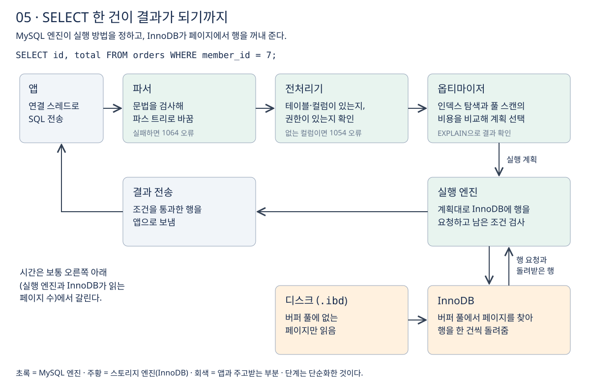

# 5장 쿼리 실행 흐름

2장에서 MySQL 엔진의 구성 요소를, 3·4장에서 InnoDB가 데이터를 저장하는 방식을 봤다. 이번 장에서는 둘을 이어서 **SELECT 한 건이 앱에서 출발해 결과로 돌아오기까지 어떤 단계를 거치는지**, 그리고 **그중 어디서 시간이 쓰이는지**를 정리한다. 강의 섹션 3의 15강에 해당한다.

## 1. 전체 흐름

다음 쿼리를 예로 든다.

```sql
SELECT id, total FROM orders WHERE member_id = 7;
```



| 단계 | 하는 일 |
| --- | --- |
| 연결 스레드 | 앱의 연결을 맡은 스레드가 SQL을 받는다 (2장) |
| 파서 | 문법을 검사하고 SQL을 다루기 쉬운 트리 구조로 바꾼다 |
| 전처리기 | 테이블·컬럼이 실제로 있는지, 권한이 있는지 확인한다 |
| 옵티마이저 | 가능한 실행 방법의 비용을 비교해 실행 계획을 고른다 |
| 실행 엔진 | 실행 계획대로 InnoDB에 행을 요청하고 결과를 만든다 |
| InnoDB | 버퍼 풀에서 페이지를 찾아 행을 돌려준다 (3·4장) |

## 2. 파서와 전처리기

**파서는 SQL이 문법에 맞는지만 보고, 전처리기는 SQL이 가리키는 대상이 실제로 있는지 본다.** 두 단계에서 나는 오류의 종류가 다르다. [MySQL 서버 오류 목록](https://dev.mysql.com/doc/mysql-errors/8.4/en/server-error-reference.html)

- 문법이 틀리면 파서 단계에서 1064 오류(`ER_PARSE_ERROR`)가 난다.
- 문법은 맞지만 없는 컬럼을 쓰면 1054 오류(`ER_BAD_FIELD_ERROR`, Unknown column)가 난다.

```sql
SELEC id FROM orders;    -- 1064: 문법 오류, 파서에서 멈춤
SELECT idd FROM orders;  -- 1054: 없는 컬럼, 전처리기에서 멈춤
```

오류 번호를 보면 쿼리가 어느 단계에서 멈췄는지 알 수 있다. 이 두 단계는 데이터를 읽지 않으므로 보통 성능 문제의 원인이 되지 않는다.

## 3. 옵티마이저

**옵티마이저는 같은 결과를 내는 여러 실행 방법 가운데 비용이 가장 적다고 추정한 방법을 고른다.** 예제 쿼리라면 `member_id` 인덱스로 찾을지, 테이블 전체를 읽을지를 정한다. 조인이 있으면 어느 테이블부터 읽을지도 정한다. [옵티마이저 비용 모델](https://dev.mysql.com/doc/refman/8.4/en/cost-model.html)

비용은 실제로 실행해 본 값이 아니라 **통계 정보를 바탕으로 한 추정**이다. 통계가 실제 데이터와 다르면 옵티마이저가 나쁜 계획을 고를 수 있다. 이 문제는 섹션 12(옵티마이저와 히스토그램)에서 다룬다.

옵티마이저가 고른 결과는 `EXPLAIN`으로, 왜 그렇게 골랐는지는 옵티마이저 추적(optimizer trace)으로 볼 수 있다. [옵티마이저 추적](https://dev.mysql.com/doc/refman/8.4/en/optimizer-tracing.html)

```sql
EXPLAIN SELECT id, total FROM orders WHERE member_id = 7;
```

`EXPLAIN`을 읽는 방법은 섹션 4에서 자세히 다룬다.

## 4. 실행 엔진과 InnoDB의 분업

실행 엔진은 실행 계획에 따라 InnoDB에 "다음 행을 달라"는 요청을 반복한다(2장의 `Handler_read_*`). InnoDB는 버퍼 풀에서 해당 페이지를 찾고, 없으면 디스크에서 읽어 온 뒤 행을 돌려준다.

**InnoDB가 돌려준 행이 곧 결과는 아니다.** 공식 문서에 따르면 기본적으로 스토리지 엔진은 인덱스로 찾은 행을 MySQL 서버에 돌려주고, WHERE 조건은 서버(실행 엔진)가 검사한다. 조건에 맞지 않는 행은 이 단계에서 버려진다. [Index Condition Pushdown](https://dev.mysql.com/doc/refman/8.4/en/index-condition-pushdown-optimization.html)

그래서 다음 두 숫자를 구분해야 한다.

- InnoDB가 읽어서 실행 엔진에 넘긴 행 수.
- WHERE 조건을 통과해 앱으로 간 행 수.

**앞의 숫자가 뒤의 숫자보다 훨씬 크면, 읽고 나서 버리는 일이 많다는 뜻이다.** 이 차이를 줄이는 것이 인덱스 튜닝의 핵심이다. 조건 검사의 일부를 InnoDB 쪽으로 내려보내는 ICP는 섹션 10에서 다룬다.

## 5. 시간은 어디서 쓰이는가

연결, 파싱, 전처리, 계획 수립은 데이터를 읽지 않으므로 대개 짧다. 동시 연결 수가 상한을 넘지 않는 한 연결 단계도 병목이 되지 않는다. **느린 쿼리의 시간은 보통 실행 단계, 곧 InnoDB가 몇 개의 페이지를 읽는지와 그 페이지가 버퍼 풀에 있는지에서 갈린다.** 구체적으로는 풀 테이블 스캔, 흩어진 페이지를 읽는 랜덤 I/O, 다른 트랜잭션의 잠금을 기다리는 시간이 주요 원인이다.

강의 실습에서는 500만 건 테이블을 인덱스 없이 훑는 조회가 약 1.3초 걸렸고, 기본키로 한 건을 찾는 조회는 약 0.0009초에 끝났다. 앞의 조회는 페이지 수만 장을 읽고, 뒤의 조회는 몇 장만 읽었기 때문이다.

다만 실행 단계에서 얼마나 읽을지는 옵티마이저가 고른 계획이 정한다. 그래서 튜닝은 두 가지로 정리된다.

- 읽어야 할 페이지와 행이 적은 실행 방법이 존재하도록 만든다 (인덱스 설계).
- 옵티마이저가 그 방법을 실제로 고르는지 확인한다 (실행 계획 확인).

2장에서 본 것처럼 지금의 MySQL에는 쿼리 결과를 그대로 재사용하는 캐시가 없으므로, 같은 쿼리도 매번 이 흐름을 처음부터 거친다.

## 이해를 확인할 질문

1. 1064 오류와 1054 오류는 각각 어느 단계에서 나는가?
2. 옵티마이저가 고르는 "비용"은 실제로 실행해 본 값인가?
3. InnoDB가 1만 행을 돌려줬는데 앱이 받은 결과가 10행이라면 무슨 일이 일어난 것인가?
4. 느린 쿼리를 튜닝할 때 인덱스를 만드는 것만으로 충분하지 않은 이유는 무엇인가?

관련 문서: [2장 MySQL 서버 구조](02-MySQL-서버-구조.md), [4장 데이터 저장 구조](04-데이터-저장-구조.md), [공부 목표](../공부%20목표.md).
