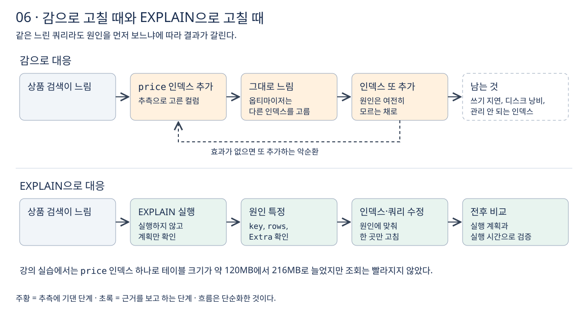

# 6장 실행 계획 필요성

느린 쿼리를 만나면 "인덱스 하나 걸면 되겠지" 하고 바로 손대고 싶어진다. 이번 장에서는 **감으로 인덱스를 추가했을 때 실제로 무슨 일이 생기는지**, 그리고 **왜 고치기 전에 실행 계획부터 봐야 하는지**를 정리한다. 강의 섹션 4의 17강에 해당한다.

## 1 감으로 인덱스를 추가하면 생기는 일

강의는 상품 검색이 느린 상황에서 조건에 쓰인 `price` 컬럼에 급하게 인덱스를 추가하는 장면으로 시작한다.

```sql
CREATE INDEX idx_product_price ON product (price);
```

결과는 두 가지였다.

- **조회 시간은 거의 그대로였다.**
- **테이블 크기는 늘었다.** 강의 실습에서는 `ANALYZE TABLE`로 통계를 갱신한 뒤 확인하니 약 120MB에서 216MB로, 인덱스 하나에 약 96MB가 더 들었다.

`ANALYZE TABLE`은 인덱스의 키 분포를 다시 분석해 저장하는 명령이다. 테이블 크기 같은 통계 값도 이때 새로 반영된다. [ANALYZE TABLE](https://dev.mysql.com/doc/refman/8.4/en/analyze-table.html)

### 왜 빨라지지 않았는가

`EXPLAIN`으로 확인하면 이유가 보인다. 새 인덱스는 `possible_keys`(쓸 수 있는 인덱스 후보)에는 올라갔지만, 실제로 쓴 인덱스인 `key`는 기존의 `category_id` 인덱스였다. **옵티마이저가 비용을 계산해 다른 인덱스가 더 낫다고 판단한 것이다.**

`category_id` 인덱스는 누가 만든 적도 없는데 있었다. 외래 키를 걸면 MySQL은 참조하는 쪽 테이블에 외래 키 컬럼으로 시작하는 인덱스가 없을 때 그 인덱스를 자동으로 만든다. [외래 키 제약 조건](https://dev.mysql.com/doc/refman/8.4/en/create-table-foreign-keys.html) **개발자가 기대한 인덱스와 옵티마이저가 고르는 인덱스는 다를 수 있다.** 이것을 확인하지 않고 인덱스를 만들면 효과를 알 수 없다.

## 2 인덱스는 공짜가 아니다

인덱스는 조회를 빠르게 하는 대신 대가를 받는다.

- **저장 공간**: 앞의 예처럼 인덱스 하나가 테이블 크기를 크게 늘릴 수 있다.
- **쓰기 비용**: `INSERT`, `UPDATE`, `DELETE`마다 모든 관련 인덱스를 함께 고쳐야 한다. [MySQL 인덱스 최적화](https://dev.mysql.com/doc/refman/8.4/en/optimization-indexes.html)

효과 없는 인덱스를 지우지 않고 또 다른 인덱스를 추가하면, 쓰기는 점점 느려지고 어떤 인덱스가 왜 있는지 아무도 모르는 상태가 된다. **원인을 모른 채 고치면 문제는 그대로 두고 비용만 쌓는 악순환에 빠진다.**



쓰이지 않는 인덱스는 `sys` 스키마의 `schema_unused_indexes` 뷰로 찾을 수 있다. 서버가 평소 부하를 충분히 오래 처리한 뒤에 봐야 의미가 있다. [schema_unused_indexes](https://dev.mysql.com/doc/refman/8.4/en/sys-schema-unused-indexes.html)

```sql
SELECT * FROM sys.schema_unused_indexes;
```

## 3 EXPLAIN: 실행하지 않고 계획을 본다

**`EXPLAIN`은 옵티마이저가 쿼리를 어떻게 처리할 계획인지 보여 준다.** 테이블을 어떤 순서로 어떻게 읽고, 어떤 인덱스를 쓰는지가 나온다. 병원에서 수술 전에 X-ray나 CT를 찍는 것과 비슷하다. [EXPLAIN](https://dev.mysql.com/doc/refman/8.4/en/using-explain.html)

```sql
EXPLAIN SELECT * FROM product
WHERE category_id = 3 AND price BETWEEN 10000 AND 20000;
```

결과에서 무엇을 보는지는 다음과 같다. 각 컬럼은 이어지는 강에서 하나씩 다룬다.

- `type`: 테이블을 어떤 방식으로 읽는가 (19·20강).
- `possible_keys`, `key`: 어떤 인덱스를 후보로 보고, 실제로 무엇을 쓰는가 (21강).
- `key_len`, `ref`: 인덱스를 어디까지, 무엇과 비교해 쓰는가 (22강).
- `rows`, `filtered`: 몇 행을 읽고 그중 얼마가 남을 것으로 보는가 (23강).
- `Extra`: 정렬이나 임시 테이블 같은 추가 작업이 있는가 (24강).

`EXPLAIN`은 계획만 보여 주므로 결과가 바로 나온다. 실제로 걸린 시간과 처리한 행 수까지 보려면 쿼리를 실제로 실행하는 `EXPLAIN ANALYZE`를 쓴다(섹션 5). [EXPLAIN ANALYZE](https://dev.mysql.com/doc/refman/8.4/en/explain.html)

## 4 근거를 보고 고치는 순서

1. `EXPLAIN`으로 실행 계획을 본다.
2. 계획에서 병목이 되는 곳을 찾는다. 예: 원하는 인덱스를 쓰지 않음, 읽는 행 수가 너무 많음, 정렬을 따로 함.
3. 원인에 맞춰 인덱스를 설계하거나 쿼리를 고친다.
4. 같은 조건에서 고치기 전후의 실행 계획과 실행 시간을 비교해 효과를 확인한다.

**급한 장애 상황일수록 이 순서를 지켜야 한다.** 감으로 고친 것이 운 좋게 맞을 수도 있지만, 틀리면 문제는 그대로이고 비용만 남는다.

## 이해를 확인할 질문

1. `price`에 인덱스를 추가했는데도 조회가 빨라지지 않은 이유는 무엇인가?
2. 만든 적 없는 `category_id` 인덱스는 어디서 생겼는가?
3. 효과 없는 인덱스를 그대로 두면 어떤 비용이 계속 드는가?
4. `EXPLAIN`과 `EXPLAIN ANALYZE`는 쿼리를 실행하는지 여부에서 어떻게 다른가?

관련 문서: [5장 쿼리 실행 흐름](../03-데이터베이스-성능과-MySQL-아키텍처/05-쿼리-실행-흐름.md), [공부 목표](../공부%20목표.md).
