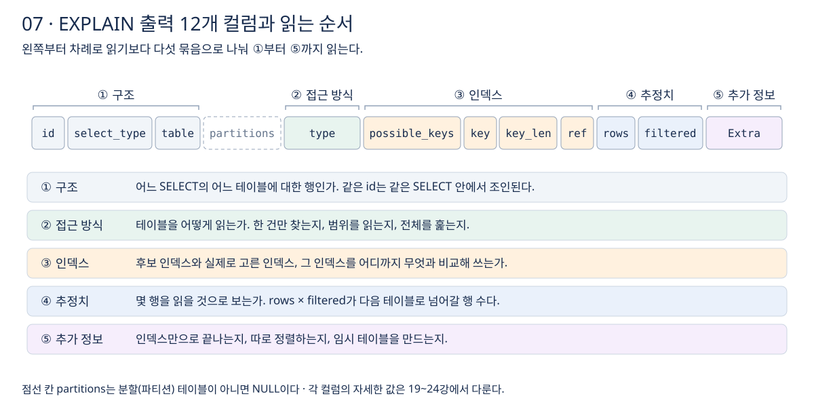

# 7장 EXPLAIN 기본 사용법

6장에서 실행 계획을 먼저 봐야 하는 이유를 정리했다. 이번 장에서는 **`EXPLAIN`을 실행하는 방법, 출력 12개 컬럼을 묶어서 읽는 방법, 결과 행의 순서와 쿼리 구조를 해석하는 방법**을 정리한다. 각 컬럼의 자세한 값은 다음 강부터 하나씩 다룬다. 강의 섹션 4의 18강에 해당한다.

## 1. 실행 방법

분석할 문장 앞에 `EXPLAIN`을 붙인다. `DESCRIBE`(`DESC`)도 같은 명령이지만, 보통 `DESC`는 테이블 구조를 볼 때, `EXPLAIN`은 실행 계획을 볼 때 쓴다. [EXPLAIN](https://dev.mysql.com/doc/refman/8.4/en/explain.html)

```sql
EXPLAIN
SELECT o.id, o.total
FROM orders o
JOIN member m ON m.id = o.member_id
WHERE m.grade = 'VIP';
```

`SELECT`뿐 아니라 `UPDATE`, `DELETE`, `INSERT`, `REPLACE`, `TABLE` 문에도 쓸 수 있다. **변경 문장도 `EXPLAIN`만 붙이면 실제로 데이터를 바꾸지 않고 계획만 본다.** 대량 `UPDATE`를 돌리기 전에 어떤 인덱스로 대상을 찾는지 확인할 때 유용하다.

## 2. 출력 12개 컬럼을 묶어서 읽기

`EXPLAIN`은 쿼리에 쓰인 테이블마다 한 행씩, 12개 컬럼으로 결과를 보여 준다. [EXPLAIN 출력 형식](https://dev.mysql.com/doc/refman/8.4/en/explain-output.html) 왼쪽부터 하나씩 읽기보다 **무엇을 알려 주는지에 따라 다섯 묶음으로 나눠 순서대로 읽으면** 판단이 빨라진다.



1. **구조**: `id`, `select_type`, `table`. 어느 `SELECT`의 어느 테이블에 대한 행인지 본다.
2. **접근 방식**: `type`. 테이블을 한 건만 찾는지, 범위로 읽는지, 전부 훑는지 본다. 가장 먼저 눈여겨볼 컬럼이다.
3. **인덱스**: `possible_keys`, `key`, `key_len`, `ref`. 후보 인덱스와 실제로 고른 인덱스(`key`가 `NULL`이면 인덱스를 쓰지 않음), 그 인덱스를 어디까지 무엇과 비교해 쓰는지 본다.
4. **추정치**: `rows`, `filtered`. 몇 행을 읽고 조건을 거친 뒤 몇 퍼센트가 남을 것으로 보는지 본다.
5. **추가 정보**: `Extra`. 인덱스만으로 끝나는지(`Using index`), 따로 정렬하는지(`Using filesort`), 임시 테이블을 만드는지(`Using temporary`) 본다.

`partitions`는 분할(파티션) 테이블에서 어느 파티션을 읽는지 보여 주며, 분할 테이블이 아니면 `NULL`이다.

### rows와 filtered로 다음 단계의 행 수 가늠하기

**`rows × filtered`가 다음 테이블과 조인될 행 수의 추정치다.** 예를 들어 `rows`가 1000이고 `filtered`가 50.00이면 다음 테이블로 넘어가는 행은 약 500개다. [EXPLAIN 출력 형식](https://dev.mysql.com/doc/refman/8.4/en/explain-output.html) 조인이 여러 단계면 각 단계의 행 수가 곱해지듯 늘어나므로, 앞쪽 테이블에서 행을 많이 줄일수록 전체 작업량이 줄어든다. 다만 모두 추정값이므로 실제 수치는 `EXPLAIN ANALYZE`(섹션 5)로 확인한다.

## 3. 결과 행의 순서와 쿼리 구조

### 행의 순서는 읽는 순서다

**`EXPLAIN` 결과의 행은 MySQL이 테이블을 읽는 순서대로 나온다.** 첫 번째 테이블에서 행을 하나 읽고, 그 행에 맞는 행을 두 번째 테이블에서 찾고, 다시 세 번째 테이블에서 찾는 식이다. [EXPLAIN 출력 형식](https://dev.mysql.com/doc/refman/8.4/en/explain-output.html) 그래서 맨 위 행이 조인의 출발점(드라이빙 테이블)이다. 조인 순서를 누가 정하는지는 섹션 13에서 다룬다.

### id와 select_type

`id`는 쿼리 안의 `SELECT` 번호다. **`id`가 같은 행들은 같은 `SELECT` 안에서 조인되는 테이블이다.** 서브쿼리나 `UNION`이 있으면 `id`가 나뉜다.

`select_type`은 그 `SELECT`가 쿼리에서 어떤 역할인지 보여 준다. 자주 보는 값은 다음과 같다. [EXPLAIN 출력 형식](https://dev.mysql.com/doc/refman/8.4/en/explain-output.html)

- `SIMPLE`: 서브쿼리나 `UNION`이 없는 단순한 `SELECT`. 조인만 있는 쿼리도 여기에 해당한다.
- `PRIMARY`: 서브쿼리나 `UNION`이 있을 때 가장 바깥쪽 `SELECT`.
- `SUBQUERY`: 서브쿼리의 첫 `SELECT`.
- `DEPENDENT SUBQUERY`: 바깥 쿼리의 값에 의존하는 서브쿼리(상관 서브쿼리). 바깥 쿼리의 값이 바뀔 때마다 다시 실행되므로 주의해서 본다.
- `DERIVED`: `FROM` 절의 서브쿼리로 만든 파생 테이블.
- `MATERIALIZED`: 결과를 임시 테이블로 만들어 둔(구체화한) 서브쿼리.
- `UNION`, `UNION RESULT`: `UNION`의 두 번째 이후 `SELECT`와, 그 결과를 합친 단계.

`table` 컬럼에는 실제 테이블 이름 대신 `<derivedN>`, `<subqueryN>`, `<unionM,N>`처럼 나올 때가 있다. `id`가 N인 행에서 만든 파생 테이블, 구체화된 서브쿼리, `UNION` 결과를 가리킨다.

## 4. 옵티마이저가 고쳐 쓴 쿼리 보기

옵티마이저는 작성한 SQL을 그대로 실행하지 않고 더 처리하기 좋은 형태로 바꾸기도 한다. 예를 들어 `IN` 서브쿼리를 조인처럼 처리하는 세미조인으로 바꾸면, 서브쿼리였던 테이블이 바깥 쿼리와 같은 `id`로 나오고 `select_type`도 `SIMPLE`이 될 수 있다. [세미조인 최적화](https://dev.mysql.com/doc/refman/8.4/en/semijoins.html)

**`EXPLAIN` 직후 `SHOW WARNINGS`를 실행하면 옵티마이저가 바꾼 형태의 쿼리를 볼 수 있다.** [EXPLAIN 확장 정보](https://dev.mysql.com/doc/refman/8.4/en/explain-extended.html)

```sql
EXPLAIN
SELECT * FROM orders
WHERE member_id IN (SELECT id FROM member WHERE grade = 'VIP');

SHOW WARNINGS;
```

결과의 `Message`에 나오는 문장은 실행 가능한 SQL이 아니라, 옵티마이저가 쿼리를 어떻게 이해했는지 보여 주는 설명용 표현이다. 작성한 쿼리와 실행 계획이 예상과 다를 때 원인을 찾는 단서로 쓴다.

## 5. 출력 형식

`FORMAT` 옵션으로 출력 형식을 고른다. [EXPLAIN 형식](https://dev.mysql.com/doc/refman/8.4/en/explain.html)

- `TRADITIONAL`: 기본값. 위에서 본 표 형식이다. 대부분 이것으로 충분하다.
- `JSON`: 비용(`cost_info`) 같은 상세 정보를 포함한다. 비용을 정밀하게 비교하거나 프로그램으로 결과를 처리할 때 쓴다.
- `TREE`: 처리 단계를 트리로 보여 준다. 조인이 여러 단계인 쿼리의 흐름을 보기 좋고, 해시 조인 사용 여부는 이 형식에서만 보인다. `EXPLAIN ANALYZE`도 이 형식으로 결과를 보여 준다.

```sql
EXPLAIN FORMAT=TREE
SELECT o.id, o.total FROM orders o
JOIN member m ON m.id = o.member_id
WHERE m.grade = 'VIP';
```

기본 형식은 `explain_format` 시스템 변수로 바꿀 수 있다. [explain_format](https://dev.mysql.com/doc/refman/8.4/en/server-system-variables.html#sysvar_explain_format)

## 이해를 확인할 질문

1. 대량 `UPDATE` 문에 `EXPLAIN`을 붙이면 데이터가 바뀌는가?
2. `EXPLAIN` 결과의 첫 번째 행은 조인에서 어떤 의미인가?
3. `id`가 같은 두 행과 `id`가 다른 두 행은 쿼리 구조에서 어떻게 다른가?
4. `rows`가 1000, `filtered`가 10.00이면 다음 테이블로 넘어가는 행은 대략 몇 개인가?
5. 서브쿼리로 작성했는데 `select_type`이 모두 `SIMPLE`로 나왔다면 무슨 일이 일어난 것이고, 어떻게 확인하는가?

관련 문서: [6장 실행 계획 필요성](06-실행-계획-필요성.md), [공부 목표](../공부%20목표.md).
