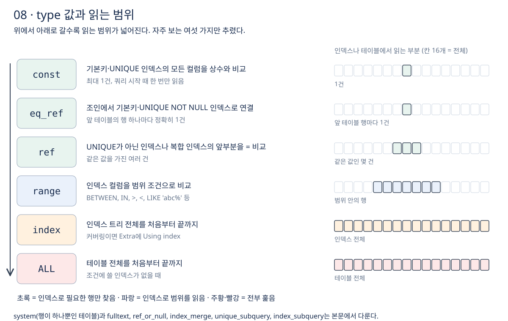

# 8장 접근 유형 type

7장에서 `EXPLAIN` 결과를 다섯 묶음으로 나눠 읽는다고 했다. 이번 장은 그중 가장 먼저 보는 **`type` 컬럼, 곧 테이블을 어떤 방식으로 읽는지**를 정리한다. 값마다 언제 나오는지, 얼마나 읽는지, 언제 문제가 되는지를 본다. 강의 섹션 4의 19·20강에 해당한다.

## 1. type이 알려 주는 것

**`type`은 MySQL이 그 테이블에서 행을 어떤 방식으로 찾는지 보여 준다.** 공식 문서는 이 값을 조인 유형(join type)이라고 부르고, 좋은 것부터 나쁜 것 순서로 나열한다. [EXPLAIN 조인 유형](https://dev.mysql.com/doc/refman/8.4/en/explain-output.html#explain-join-types)

```text
system > const > eq_ref > ref > fulltext > ref_or_null > index_merge
       > unique_subquery > index_subquery > range > index > ALL
```

실무에서 자주 보는 것은 `const`, `eq_ref`, `ref`, `range`, `index`, `ALL` 여섯 가지다. 아래로 갈수록 읽는 범위가 넓어진다.



## 2. 한 건만 찾는 유형: system, const, eq_ref

### const

**기본키나 UNIQUE 인덱스의 모든 컬럼을 상수와 `=`로 비교하면 `const`가 된다.** 맞는 행이 최대 한 건이므로 쿼리를 시작할 때 한 번만 읽고, 그 행의 값을 나머지 처리에서 상수처럼 쓴다. 데이터가 아무리 많아도 거의 즉시 끝난다.

```sql
SELECT * FROM orders WHERE id = 1001;                  -- 기본키
SELECT * FROM member WHERE email = 'kim@example.com';  -- UNIQUE 인덱스
```

복합 기본키라면 모든 컬럼을 상수로 비교해야 `const`가 된다. 일부만 비교하면 한 건이라는 보장이 없으므로 `ref`나 `range`로 내려간다.

`system`은 행이 딱 하나뿐인 테이블에서 나오는 `const`의 특수한 경우다. 실무에서는 거의 볼 일이 없다.

### eq_ref

**조인에서 뒤쪽 테이블을 기본키나 UNIQUE NOT NULL 인덱스로 찾으면 `eq_ref`가 된다.** 앞 테이블의 행 하나마다 뒤 테이블에서 정확히 한 건만 읽는다. `system`과 `const`를 빼면 가장 좋은 조인 방식이다.

```sql
SELECT o.id, m.name
FROM orders o
JOIN member m ON m.id = o.member_id;   -- member는 기본키로 찾으므로 eq_ref
```

이때 `ref` 컬럼에는 비교 대상인 `o.member_id`가 나온다. **UNIQUE 인덱스라도 컬럼이 NULL을 허용하면 `eq_ref`가 되지 않는다.** NULL은 UNIQUE 인덱스에서도 여러 행에 들어갈 수 있어 정확히 한 건을 보장하지 못하기 때문이다. [CREATE INDEX](https://dev.mysql.com/doc/refman/8.4/en/create-index.html)

## 3. 같은 값을 여러 건 찾는 유형: ref

**UNIQUE가 아닌 인덱스로 `=` 비교하거나, 복합 인덱스의 앞쪽 컬럼만 `=` 비교하면 `ref`가 된다.** 같은 값을 가진 행이 여러 건일 수 있다는 점이 `const`, `eq_ref`와 다르다.

```sql
SELECT * FROM orders WHERE member_id = 7;    -- member_id는 일반 인덱스
SELECT * FROM product WHERE category_id = 3;
```

공식 문서는 **그 값에 해당하는 행이 몇 건뿐이면 좋은 방식**이라고 설명한다. 반대로 같은 값을 가진 행이 아주 많으면 `ref`여도 많이 읽는다. `type`만 보고 안심하지 말고 `rows`(23강)를 함께 봐야 하는 이유다.

`ref_or_null`은 `ref`에 더해 NULL인 행을 한 번 더 찾는 방식이다. `WHERE key_col = 7 OR key_col IS NULL` 같은 조건에서 나온다.

## 4. 범위를 읽는 유형: range

**인덱스 컬럼을 범위 조건으로 비교하면 `range`가 된다.** 인덱스에서 범위의 시작을 찾은 뒤, 범위가 끝날 때까지 이어서 읽는다.

```sql
SELECT * FROM orders WHERE created_at BETWEEN '2026-10-01' AND '2026-10-31';
SELECT * FROM product WHERE category_id IN (3, 5, 7);
SELECT * FROM product WHERE name LIKE '노트북%';
```

공식 문서에 따르면 `>`, `>=`, `<`, `<=`, `BETWEEN`, `IN()`, `LIKE`, `IS NULL` 등으로 인덱스 컬럼을 상수와 비교할 때 쓸 수 있다. `range`일 때 `ref` 컬럼은 `NULL`이다. [EXPLAIN 조인 유형](https://dev.mysql.com/doc/refman/8.4/en/explain-output.html#explain-join-types)

**`range`는 인덱스를 잘 쓰고 있다는 뜻이지만, 범위가 넓으면 느리다.** 한 달 치를 조회하는 쿼리와 5년 치를 조회하는 쿼리는 같은 `range`라도 읽는 양이 전혀 다르다. 범위가 테이블의 큰 비율을 차지하면 옵티마이저는 아예 `ALL`을 고르기도 한다(6장). 인덱스가 없는 컬럼에 범위 조건을 걸면 `range`가 아니라 `ALL`이 된다.

## 5. 전부 훑는 유형: index, ALL

### index

**`index`는 테이블 대신 인덱스 트리를 처음부터 끝까지 읽는다.** 이름 때문에 좋아 보이지만 "인덱스를 전부 훑는다"는 뜻이다. 공식 문서는 두 가지 경우를 든다.

- **인덱스만으로 쿼리를 끝낼 수 있을 때**: 필요한 컬럼이 모두 인덱스에 있으면(커버링 인덱스) 인덱스만 읽는다. `Extra`에 `Using index`가 나온다. 인덱스는 보통 테이블보다 작으므로 `ALL`보다 빠른 편이다.
- **인덱스 순서대로 테이블 전체를 읽을 때**: 인덱스 순서를 따라가며 실제 행을 하나씩 찾아간다. `Using index`가 나오지 않는다. 행을 찾으러 테이블 여기저기를 오가는 랜덤 I/O가 생겨 `ALL`보다 느릴 수도 있다.

커버링 인덱스는 섹션 8과 10에서 자세히 다룬다.

### ALL

**`ALL`은 테이블 전체를 처음부터 끝까지 읽는 풀 테이블 스캔이다.** 조건에 쓸 수 있는 인덱스가 없으면 `possible_keys`와 `key`가 모두 `NULL`이고 `type`은 `ALL`이 된다. 공식 문서는 조인의 첫 테이블이 아닌 곳에서 나오면 대개 아주 나쁘다고 설명한다. 앞 테이블의 행마다 뒤 테이블 전체를 다시 읽기 때문이다.

다만 **`ALL`이 항상 나쁜 것은 아니다.** 행이 수십~수천 건인 작은 테이블은 인덱스를 거치는 것보다 그냥 읽는 편이 빠를 수 있다. 개선 대상은 데이터가 많은 테이블에서 나오는 `ALL`이다.

## 6. 그 밖의 값

- `fulltext`: 전문(FULLTEXT) 인덱스로 찾는다.
- `index_merge`: 인덱스 여러 개를 함께 써서 결과를 합친다. `key`에 인덱스 목록이 나온다(섹션 11).
- `unique_subquery`, `index_subquery`: `IN (SELECT ...)` 서브쿼리를 인덱스 조회 함수로 바꿔 처리한다. 서브쿼리가 기본키를 찾으면 `unique_subquery`, 일반 인덱스를 찾으면 `index_subquery`다.

## 7. 실행 시간을 비교할 때 주의할 점

`type`이 바뀐 효과를 실행 시간으로 확인할 때는 **클라이언트 도구가 결과 행 수를 자동으로 제한하지 않는지** 확인한다. 예를 들어 MySQL Workbench는 기본으로 결과를 1,000행까지만 가져오므로, 전체를 읽는 쿼리도 빨리 끝난 것처럼 보일 수 있다. 정확히 비교하려면 이 제한을 끄거나, 쿼리를 실제로 끝까지 실행해 단계별 시간을 보여 주는 `EXPLAIN ANALYZE`(섹션 5)를 쓴다. [EXPLAIN ANALYZE](https://dev.mysql.com/doc/refman/8.4/en/explain.html#explain-analyze)

## 이해를 확인할 질문

1. `const`와 `eq_ref`는 둘 다 한 건을 찾는데 무엇이 다른가?
2. UNIQUE 인덱스로 조인했는데 `eq_ref`가 아니라 `ref`가 나왔다면 무엇을 의심하는가?
3. `type`이 `ref`인데도 느릴 수 있는 이유는 무엇인가?
4. `index`가 `ALL`보다 빠른 경우와 느린 경우는 각각 언제인가?
5. 작은 테이블의 `ALL`을 굳이 고치지 않아도 되는 이유는 무엇인가?

관련 문서: [7장 EXPLAIN 기본 사용법](07-EXPLAIN-기본-사용법.md), [공부 목표](../공부%20목표.md).
