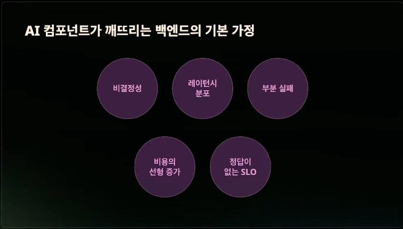
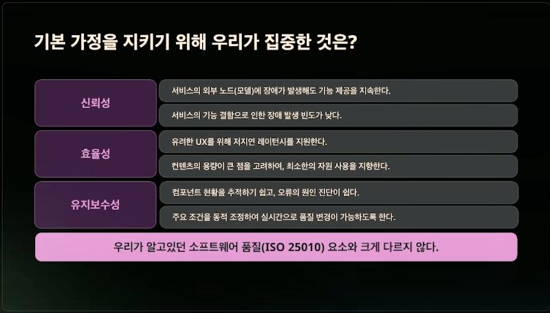
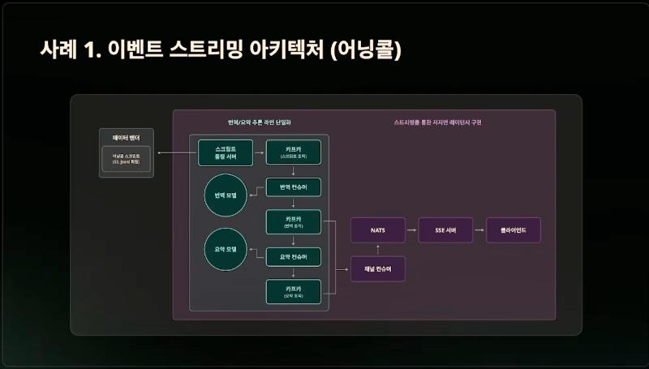
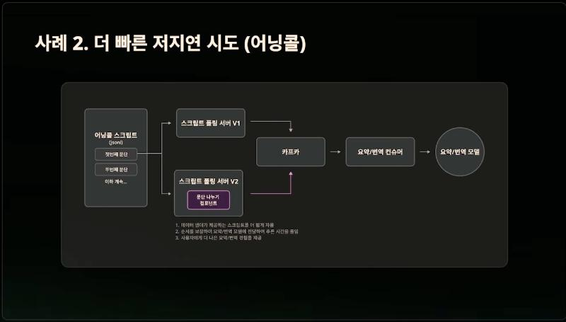
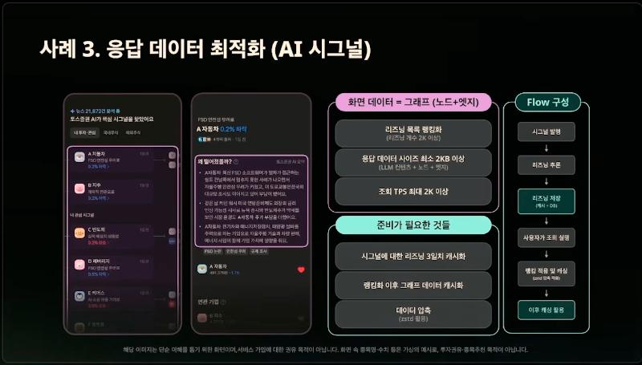
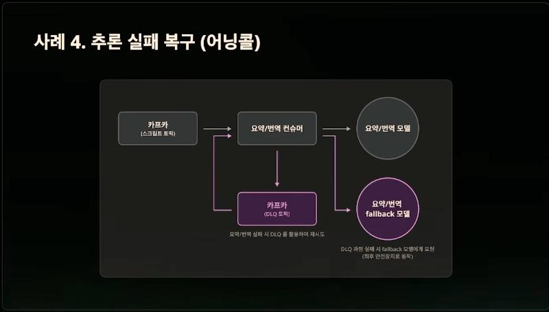
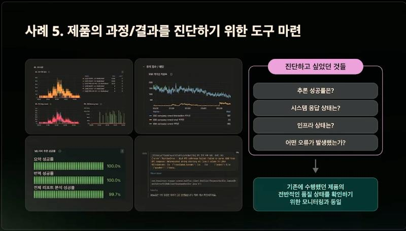
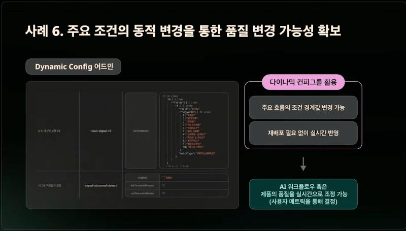
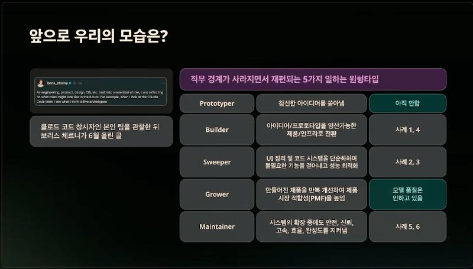

# 토스증권 - 토스증권 AI 서비스를 지탱하는 백엔드 엔지니어링

> 출처: [토스 챌린저스 유튜브](https://www.youtube.com/watch?v=lfyKfUFf-sk)
>
> 토스증권 AI 제품 조직의 백엔드 엔지니어 발표다. YouTube 자동 생성 자막을 바탕으로 정리했으므로 고유명사와 수치는 자막 인식 오류가 있을 수 있다. 그림은 발표 영상의 화면을 캡처한 것이고, 각 그림 아래에 영상 속 시각을 적었다.

## 한 줄 요약

**AI 모델을 파이프라인 안의 "외부 노드"로 보는 순간, 이벤트 스트리밍·DLQ·캐싱·압축·모니터링·다이나믹 컨피그 같은 익숙한 백엔드 기법이 그대로 통한다.** 새로 배운 기술은 거의 없었다. 남은 과제는 생성 결과의 품질을 관측하는 일과, 직군 경계가 흐려지는 환경에서 일하는 방식을 바꾸는 일이다.

배경은 2025년 상반기 규제 샌드박스로 금융권에서도 생성형 AI를 쓸 수 있게 된 것이고, 첫 제품은 해외 기업 어닝콜(실적 발표)을 실시간으로 번역·요약하는 서비스였다. 사례는 이 어닝콜과 이후의 AI 시그널 두 제품에서 나온다.

## 1. AI 컴포넌트가 깨뜨리는 백엔드의 기본 가정

*영상 1:20*

| 성질 | 무엇이 깨지나 |
| --- | --- |
| 비결정성 | 같은 입력에 다른 출력이 나온다. 멱등하지 않고, 테스트가 `equals`로 끝나지 않는다 |
| 레이턴시 분포 | p99가 기본 초 단위다. **타임아웃 설계가 곧 UX 설계**가 된다 |
| 부분 실패 | 응답은 200 OK인데 내용이 틀린 실패가 있다 |
| 비용의 선형 증가 | 사용량에 비용이 비례하므로 스케일 아웃이 무조건 답이 아니다 |
| 정답이 없는 SLO | 가용성은 200이냐 500이냐로 명확하지만, 출력 품질은 측정 장치를 직접 만들어야 한다. 없으면 며칠 뒤 고객 문의로 알게 된다 |

이 다섯 가지를 **소프트웨어 품질 특성(ISO/IEC 25010)**에 연결하면 방향이 보였다. 비결정성과 부분 실패는 신뢰성, 고르지 않은 레이턴시와 늘어나는 비용은 효율성, 정답이 없는 SLO는 당장 다 풀 수 없어 유지보수성 쪽에서 접근한다.

*영상 2:20*

## 2. 여섯 가지 사례

| 사례 | 품질 특성 | 문제 | 해결 |
| --- | --- | --- | --- |
| 1 어닝콜 스트리밍 | 효율성 | 외부 업체가 주는 영어 스크립트를 실시간으로 번역·요약해 전달해야 한다 | 폴링 수집 → Kafka 번역·요약 → SSE 브로드캐스트. 어닝콜당 추론 1회 |
| 2 문단 나누기 | 효율성(시간) | 스크립트가 문단 단위라 토큰이 커서 추론이 느리다 | 문단을 짧게 자르고 순서를 보장해 모델에 보낸다 |
| 3 AI 시그널 응답 | 효율성(자원) | 매 요청 랭킹 대상 조회로 DB 부하, 응답이 크다 | DB와 캐시에 동시 적재(DB는 폴백), 랭킹 결과 캐싱과 zstd 압축 |
| 4 추론 실패 복구 | 신뢰성 | 동시에 여러 어닝콜이 열리면 추론 타임아웃 | DLQ 재시도, 그래도 실패하면 폴백 모델 |
| 5 진단 도구 | 유지보수성 | 서버가 살아 있는지는 보이는데 번역·요약이 실제로 성공하는지 안 보인다 | 추론 성공률, 시스템 응답, 인프라, 오류를 한 대시보드에 |
| 6 다이나믹 컨피그 | 유지보수성 | 품질을 좌우하는 조건값을 바꾸려면 배포가 필요한데 장중 배포가 어렵다 | 조건값을 어드민의 동적 설정으로 빼서 재배포 없이 반영 |

### 사례 1. 이벤트 스트리밍 아키텍처 (어닝콜)

*영상 3:30*

- 외부 업체가 오디오 스트림과 스크립트를 주는데, 스크립트는 S3의 JSONL 파일이 실시간으로 갱신되는 형태였다. 어닝콜이 시작되면 폴링 서버가 이를 수집해 Kafka에 넣는다.
- 번역 컨슈머와 요약 컨슈머가 각각 모델을 호출하고 결과를 다시 Kafka 토픽에 넣는다. 채널 컨슈머가 NATS를 거쳐 SSE 서버로 클라이언트에 브로드캐스트한다.
- 노린 것은 두 가지다. **시청자가 몇 명이든 어닝콜 하나당 추론은 한 번**만 해서 비용을 최소화하고, 추론 자체가 초 단위로 걸리므로 **추론 이후 전달 구간의 지연**을 최대한 줄인다. 번역·요약 품질은 모델 쪽에 맡기고 백엔드는 전달 구조를 책임진다.

### 사례 2. 더 빠른 저지연 시도 (어닝콜)

*영상 4:45*

출시 후 사용자가 번역·요약을 꽤 오래 기다린다는 것을 알았다. 원인은 스크립트가 문장이 아니라 **문단 단위**로 들어와 한 번에 추론하는 토큰이 컸기 때문이다. 폴링 서버 안에 문단 나누기 컴포넌트를 두어 더 짧게 자르고 **순서를 보장해** 모델에 보내자 추론 시간이 줄었다.

### 사례 3. 응답 데이터 최적화 (AI 시그널)

*영상 5:35*

메인 화면은 특정 시점에 만들어진 리즈닝(판단 근거) 목록을 랭킹한 상위 30개와 연관 종목 그래프다. 랭킹 대상이 최대 2천 개, 이 화면의 조회가 최대 2천 TPS이고, 응답은 그래프와 LLM 생성 텍스트를 담아 수 KB가 넘는다.

- **리즈닝을 만드는 AI 워크플로우가 DB와 캐시에 동시에 적재**하고, 조회는 캐시에서 하며 DB는 폴백으로만 쓴다.
- 랭킹이 적용된 그래프 데이터는 만들 때 CPU를 많이 쓰므로 캐싱하고, 캐시 크기를 고려해 **zstd로 압축**한다.

### 사례 4. 추론 실패 복구 (어닝콜)

*영상 6:40*

오디오와 텍스트가 맞물려 가는 제품이라 번역이나 요약이 하나만 빠져도 경험이 무너진다. 같은 시간에 어닝콜 여러 개가 열리자 모델 추론에 부하가 걸려 타임아웃이 났다.

**DLQ로 재시도하고, 그마저 실패하면 비슷한 품질을 내는 폴백 모델로 보낸다.** 발표자는 AI 모델을 파이프라인의 외부 노드처럼 바라보면 예전부터 쓰던 전략이 그대로 적용된다는 점을 강조했다.

### 사례 5. 제품의 과정과 결과를 진단하는 도구

*영상 7:45*

어닝콜은 실시간 제품이라 진행 중에 문제를 못 찾으면 그대로 끝난다. 그래서 네 가지를 보게 했다. **추론 성공률**(번역·요약·리포트 분석 각각), **시스템 응답 상태**(실제 시청자 수를 보여 주는 SSE 커넥션 수. 추론이 잘돼도 연결이 끊기면 사용자에게 아무것도 가지 않는다), **인프라 상태**, **어떤 오류가 났는지**.

지표를 정의하고 대시보드를 만들고 임계치에 알림을 거는 것은 원래 하던 일이고, 관측 대상에 AI 모델이 추가됐을 뿐이다. 단, **성공률은 "실패하지 않았다"는 뜻이지 "좋은 결과가 나왔다"는 뜻이 아니다.**

### 사례 6. 주요 조건의 동적 변경

*영상 8:55*

AI 워크플로우를 운영해 보니 **제품 품질을 결정하는 것이 코드보다 조건값**인 경우가 많았다. 어떤 뉴스를 시그널 후보로 볼지 정하는 키워드 목록, 이상 판단 임계값 같은 것이다. 이 값의 정답은 처음부터 알 수 없고 사용자 반응을 보며 찾아가야 한다.

상수로 두면 값 하나 바꾸는 데 배포가 필요한데, 증권은 장중 배포가 자유롭지 않고 조정이 가장 필요한 때가 바로 장중이다. 그래서 다이나믹 컨피그로 빼서 어드민에서 바꾸면 바로 반영되게 했다. 사례 5의 대시보드로 보고, 여기서 조정하고, 다시 결과를 보는 순환이 생겼다.

## 3. 기술 다음의 문제: 일하는 방식

여섯 사례를 늘어놓으니 모두 원래 알던 방법이었고, AI 제품도 안정적으로 만들 수 있다는 자신감을 얻었다. 다음 문제는 기술이 아니었다.

- AI가 숙련도 장벽을 낮추면서 디자이너가 동작하는 시제품을 만들고, 엔지니어가 화면 흐름과 문구를 손대는 일이 늘었다. AI 제품·인프라 전담 조직이 생기고 직군을 넘나들며 기술 스택도 넘나든다.
- 할 일이 늘었다. 원래 하던 일에 AI 워크플로우·에이전트 개발, 모델용 데이터 수집과 정제가 얹혔다.
- 제품 출시는 빨라지는데 직군 경계에서 병목이 생기고, 익숙하지 않은 스택이라 안정화 기간도 길어진다. **제품 하나의 품질은 지킬 수 있게 됐지만 제품을 만드는 속도가 막히기 시작했다.**

*영상 11:58*

발표자는 Claude Code를 만든 Boris Cherny가 팀을 관찰하고 쓴 글에서, 직무 경계가 녹으면서 남는 다섯 가지 일하는 원형을 가져왔다. 앞의 사례를 대 보니 이미 세 칸을 채우고 있었다.

| 원형 | 하는 일 | 대응 |
| --- | --- | --- |
| Builder | 아이디어와 프로토타입을 양산 가능한 제품·인프라로 바꾼다 | 사례 1, 4 |
| Sweeper | 구조를 단순하게 하고 불필요한 것을 걷어내며 성능을 최적화한다 | 사례 2, 3 |
| Maintainer | 확장 중에도 안전·신뢰·효율을 지킨다 | 사례 5, 6 |
| Prototyper | 새 아이디어를 직접 만들어 본다 | 아직 못 함 |
| Grower | 제품을 반복 개선해 시장 적합성을 높인다 | 모델 품질은 아직 못 함 |

남은 두 칸을 채우려고 바꾸는 것은 세 가지다.

1. **ML 지식 의존도가 낮은 LLM 애플리케이션과 워크플로우는 서버 엔지니어가 직접 만든다.** 모델 성능을 올리는 일은 ML 엔지니어의 몫이지만, 프롬프트를 조합하고 도구를 붙이고 흐름을 제어하는 수준이면 서버 엔지니어가 더 빠르다. 그래서 Python, LangChain, LangGraph를 익히고 있는데, 더 어려운 것은 **기존 배포 파이프라인·모니터링·사내 인증에 새 스택을 녹이는 일**이라 공통 라이브러리와 모니터링 도구를 함께 준비한다.
2. **프로토타이핑 단계부터 서버 엔지니어가 참여한다.** 워크플로우가 다 만들어진 뒤 "서빙해 주세요"로 넘어오면 정해진 구조에서 지연만 줄여야 해서 설계 선택지가 좁다. 문단 나누기도 더 앞에서 개입했다면 처음부터 다르게 설계했을 것이다.
3. **시스템 지표를 넘어 생성 결과의 품질까지 관측한다.** 추론이 성공했는지는 보이지만 결과가 좋은지는 아직 시스템이 답하지 못한다. Langfuse로 추론 과정을 추적하고 품질 지표를 정의해 개선 과정으로 잇는 작업을 준비 중이다.

## 4. 발표자의 정리

1. **AI 제품의 특성을 기존 소프트웨어 품질 요소에 연결했다.** AI 모델을 외부 노드로 보면 익숙한 전략이 다시 유효해진다.
2. **제품 현황을 알 수 있는 도구가 필수다.** 기존 지표에 더해 생성 데이터의 품질까지 볼 수 있어야 한다.
3. **역할을 나누기보다 새로운 방법을 고민한다.** 많은 일이 "이게 내 일인가"를 따지지 않았기 때문에 가능했다.

## 5. 내 생각과 연결

- **AI 모델은 느리고 가끔 틀리는 외부 API다.** 타임아웃, 재시도, DLQ, 폴백은 [5번 HTTP·외부 API와 실패 처리](../05-HTTP-외부-API와-실패-처리/공부%20목표.md)에서 다루는 것과 같다. 차이는 "200인데 틀린 응답"이 정상 경로에 섞인다는 점이고, 그래서 성공률과 품질 지표를 따로 둬야 한다.
- **비싼 계산은 소비자 수와 분리한다.** 시청자가 몇 명이든 추론은 한 번 하고 결과를 브로드캐스트하는 구조는, 시스템 디자인 연습 문제의 뉴스피드에서 비교하는 "쓰기 시 배포"와 같은 발상이다. 비용이 사용량에 비례하는 컴포넌트일수록 앞단에서 한 번만 계산하고 뒤에서 퍼뜨린다.
- **순서를 지키며 잘게 나눈다.** 사례 2의 "짧게 자르되 순서 보장"은 [OMS 설계](../13-시스템-디자인/공부%20목표.md)에서 주문 키로 묶어 순서를 지킨 것과 같은 문제다. 나누면 빨라지지만, 나눈 조각의 순서를 누가 보장하는지 정해야 한다.
- **품질을 좌우하는 값은 설정으로 뺀다.** OMS 설계의 안전 재고 최솟값, 재고 전송 주기의 소진 예상 시간 기준처럼 운영하면서 맞춰 갈 값은 처음부터 동적 설정 후보로 표시해 두는 것이 좋겠다. 바꾼 값과 결과를 같이 볼 대시보드가 짝이다.
- **"성공률 100%"를 조심한다.** 사례 5의 대시보드에서 성공률이 100%여도 결과가 좋다는 뜻은 아니다. 지표를 정의할 때 "이 지표가 좋아도 사용자가 불만일 수 있는 경우"를 함께 적어 두면 빈칸이 보인다.

## 더 볼 것

- [ ] ISO/IEC 25010의 품질 특성 분류를 확인하고, 공부 중인 설계 문서의 비기능 요구를 이 분류로 정리해 본다.
- [ ] SSE와 WebSocket으로 다수 클라이언트에 브로드캐스트할 때 연결 수와 서버 대수의 관계, 중간 메시지 브로커(NATS 등)가 필요한 이유를 확인한다.
- [ ] Langfuse 같은 LLM 추적 도구가 추론 과정의 어떤 정보를 남기는지 확인한다.
